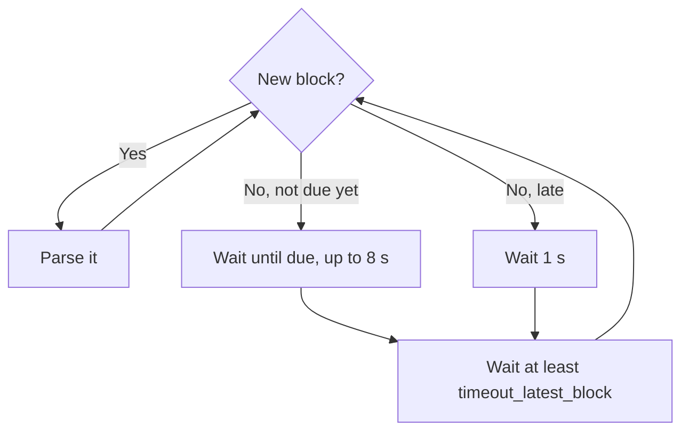

# Parser

The parser follows each chain's new blocks and publishes their transactions to the consumers. Each chain has a row in `parser_state`, read on every loop, so a change applies without a restart.

## Settings

| Column | Effect |
| --- | --- |
| `is_enabled` | Parses the chain. A disabled chain resumes where it stopped. |
| `block_time` | Average milliseconds between blocks. Sets when to look for the next block. |
| `await_blocks` | Stays this many blocks behind the tip. |
| `parallel_blocks` | Blocks fetched together in one batch. Speeds up catch-up without adding requests. |
| `queue_behind_blocks` | More than this many blocks behind, blocks go to the queue instead of being parsed inline. |
| `timeout_between_blocks` | Pause in milliseconds after each batch, for nodes that rate-limit. |
| `timeout_latest_block` | Shortest gap in milliseconds between checks for a new block. 0 lets `block_time` decide. |

## Checking for a new block

Until the next block is due, the parser waits, at most `parserMaxCheckInterval` (8 s) at a time. Once the block is late, it checks every `parserMinCheckInterval` (1 s). No wait is shorter than `timeout_latest_block`.

## Slowing a chain down

Set `timeout_latest_block` for a chain that doesn't need its transactions within seconds, or whose blocks come at random times, such as Bitcoin or Cardano: a late block there can be minutes away, and checking it every second wastes requests. A 20 s chain with a block 14 s late:

```mermaid
gantt
    dateFormat ss
    axisFormat %S s
    section Default
    Wait until due : 00, 20
    Late, check every 1 s : crit, 20, 34
    Block : milestone, 34, 0s
    section 10 s minimum
    Check every 10 s : 00, 40
    Block : milestone, 34, 0s
```

The default finds the block at 34 s after 17 checks. With the 10 s minimum it takes 4 checks and finds the block at 40 s.
