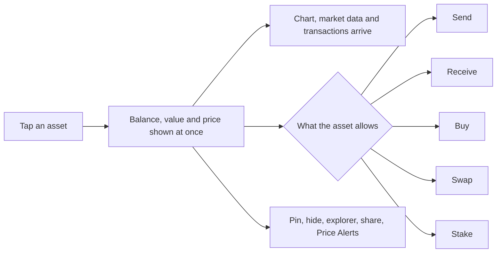
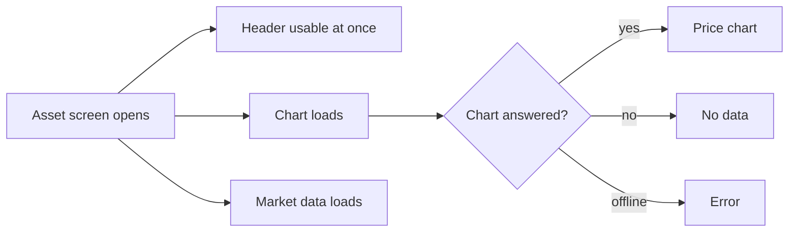
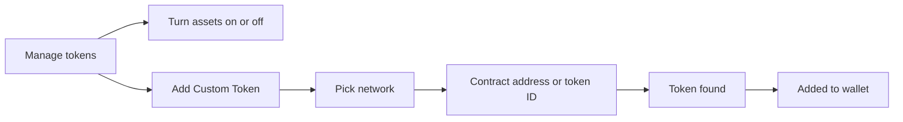

# Assets

One asset's screen, the tokens a wallet shows, and the assets the user picks from.

## Asset screen

1. Tapping an asset shows its balance and value, the price with its change, the actions the asset allows (Send, Receive, Buy, Swap, Stake), its price chart and market data ([Market](#market)), its balance breakdown, and its transactions.
2. The user can pin or hide the asset, open it on the explorer, share it, and set Price Alerts.

| When | Expected | Why |
|---|---|---|
| The asset screen opens | chart, history and market data load at the same time; the header is usable while they arrive | |
| The asset still needs activation, or its account is blocked by multisig | the header actions are disabled, the empty history offers no Buy or Swap, and the Stake balance row opens nothing | the asset cannot receive yet, or this wallet cannot sign for the account; a purchase, swap or stake would fail |
| Receive opens for an asset that was never refreshed, or not in the last hour | the asset is refreshed, so the network selector lists every network the wallet holds it on | the networks are known only once the asset has been fetched |
| The user switches network on Receive | the selector keeps every network it listed when Receive opened, the first one included | the user can switch back without leaving the screen |

Account requirements follow the shared [Network minimums and activation](../PRODUCT.md#network-minimums-and-activation) section.

## Market

1. The asset screen shows the price chart and the asset's market data under the header.

The chart follows the shared [Charts](../PRODUCT.md#charts) section.

| When | Expected | Why |
|---|---|---|
| The asset has candles | a button beside the periods switches the price chart between a line and candlesticks; the choice is remembered for every asset | traders read each period's open, high, low and close |
| The asset has no candles | the line shows with no button, whatever the user picked on another asset | a button that cannot work is not offered |
| Candlesticks show | the periods start at `1D`, and a chart on `1H` moves to `1D` | an hour holds too few candles to read |
| Candlesticks show | prices are in the wallet's currency, and the last candle follows the latest price; there is no volume | the header must agree with the rest of the asset screen, and the source has no volume per candle |
| Candlesticks cannot load | it shows that there is no data, only being offline shows an error, and the button still switches back to the line | the line may still be available |

## Manage tokens

1. The user turns assets on or off for the wallet.
2. A custom token is looked up by its contract address or token ID and added to the wallet.

| When | Expected | Why |
|---|---|---|
| An asset is turned off | it leaves the list and keeps its data | |
| The custom token is unverified | "Know What You're Adding" shows before it is added | |
| The user picks an asset | Recents: the assets the user recently used, per wallet, most recent first | |
| The list below Recents is filtered | Recents follow the same filters | picking an asset to sell never offers one that cannot be sold |

## Toasts

Toasts follow the shared [Toasts](../PRODUCT.md#toasts) section.

| When | Toast | Shows on |
|---|---|---|
| An asset is pinned | 📌 Pinned: Bitcoin | the asset or the asset picker |
| An asset is unpinned | 📌 Unpinned: Bitcoin | the asset or the asset picker |
| A token is added | ➕ Added to wallet | the asset or the asset picker |
| Price alerts for the asset are turned on | 🔔 Price alert enabled for Bitcoin | the asset |
| Price alerts for the asset are turned off | 🔔 Price alert disabled for Bitcoin | the asset |
| A token is added but its balance cannot load | ❌ the reason | the asset or the asset picker |
| Turning price alerts on or off fails | ❌ the reason | the asset |
