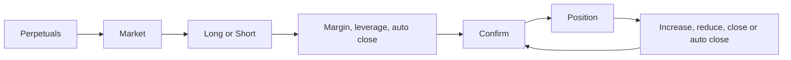
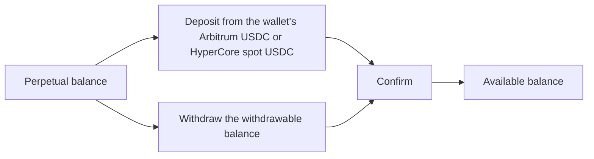

# Perpetuals

Go long or short on Hyperliquid markets with leverage, from a USDC balance the user deposits and withdraws inside the app. Multi-Coin wallets only.

1. The user switches Perpetuals on in Settings or from the "Trade Perpetuals on Hyperliquid" banner; the wallet screen gains a Perpetuals section and the Portfolio a Perpetuals view.
2. The Perpetuals list shows the balance with Deposit and Withdraw, then Positions, Pinned and Markets; prices and their 24h change move live.
3. A market shows a candlestick chart with a period picker, Long and Short, Volume, Open Interest and Funding APR, the asset it tracks, and its activity.
4. Long or Short takes the USDC margin, a leverage from `1x` to the market's cap, and an Auto Close prefilled from the default take profit and stop loss.
5. Confirm shows the position ("Long 5x"), the size, the price with `2%` slippage, and the take profit and stop loss prices.
6. After a position is opened, closed, increased, reduced or modified, a message confirms what was done ("Open Long", "Close position").
7. A position shows its PnL with percent, Auto Close, Size, Entry Price, Liquidation price, Margin and Funding Payments; Modify increases or reduces it.
8. Deposit moves USDC from the wallet's Arbitrum account, at least `5 USDC`, or, on a standard Hyperliquid account, from its HyperCore spot USDC; Withdraw moves the withdrawable balance back, at least `2 USDC`, plus Hyperliquid's `1 USDC` network fee.

## Markets

Markets come from two sets on Hyperliquid:

| Set | Markets | Shown as |
|---|---|---|
| Hyperliquid's own markets | Bitcoin, Ether, Solana | `BTC`, `ETH`, `SOL` |
| xyz markets: stocks, indexes and commodities that trade.xyz runs on Hyperliquid | Apple, Nvidia, WTI crude oil, Brent crude oil | `xyz:AAPL`, `xyz:NVDA`, `xyz:CL`, `xyz:BRENTOIL` |

## Expected results

| When | Expected | Why |
|---|---|---|
| The wallet is not Multi-Coin or has no Hyperliquid account, or the user has not switched Perpetuals on | Perpetuals are not offered, and a Perpetuals link leaves the app where it is | a link opens only what the wallet screen shows |
| The user switches Perpetuals off | the markets, positions and every wallet's perpetual recents are removed | search must not offer a market the app no longer has |
| The user switches Perpetuals on | the markets load before the Hyperliquid socket subscribes; if they cannot load, the next launch or return to the foreground tries again | a position is stored against its market, so the first account snapshot needs the markets |
| The app launches, returns to the foreground or switches wallet | cached positions show immediately, then the Hyperliquid socket replaces them with its current account snapshot; neither the REST position refresh, the account mode lookup, a markets refresh nor the wallet's balance setup delays opening the socket | only the account subscriptions need the mode, so the lookup runs during the socket handshake; stored markets refresh when Perpetuals opens |
| A position's market is not stored yet | the balance and the other positions still update; that position appears once the markets refresh | a balance or a position never waits on another position's market |
| A market's price moves while the list is open | its 24h change moves with it | the change next to the price must agree with it and with Hyperliquid |
| The user returns to a market, from another screen or the background | its chart, position and activity reload without a spinner; a pull shows the spinner until they land | the chart misses candles while the market is not on screen |
| A perpetual price shows (the chart, a market row, a position's Entry, Liquidation and Auto Close prices, Auto Close, confirmation, activity) | in Hyperliquid's places for that market: five significant figures and at most six minus the market's size decimals, so XRP reads `$1.4251` and BTC `$123,456`; the chart's axis and tooltip keep the places of the latest close | a market near a dollar moves in the fourth place, which two places hid; the price must read the same as on Hyperliquid |
| A position's PnL percent shows (the Positions list, the position, the close confirmation) | the return on the margin the position opened with, its entry value over its leverage, so a `5x` long whose price rose `10%` reads `+50%` | it must read as Hyperliquid's ROE and as the percent the user set in Auto Close; the margin in use grows and shrinks with the PnL, so against it a gain reads smaller and a loss larger |
| The user long-presses a market | it is pinned | |
| The user searches | positions and markets are filtered | |
| Hyperliquid delists a market | it leaves the list, pins and search; its trades stay in Activity and still open it, without Long or Short | a delisted market cannot be traded, but past trades keep their market |
| An xyz market trades under `$1M` a day | it is treated like a delisted market: not offered, while a position in it still shows and closes | a thin market fills far from its price |
| xyz does not answer a refresh while Hyperliquid's own markets do | Hyperliquid's markets and positions refresh; xyz keeps its last markets, positions and balance until it answers (`test_a_refresh_missing_a_dex_keeps_that_dexs_positions_and_the_balance`) | one market operator's outage does not stop the others, and nothing the user holds disappears from the screen |
| A position is open on a delisted or not-offered market | Modify offers only Reduce | the position can be wound down but not grown in a market that is no longer traded |
| A market's name shows (the list, search, a position, a pin, a toast) | Hyperliquid's own markets by their plain name, `BTC`; xyz markets with their `xyz:` prefix, `xyz:AAPL`, the name Hyperliquid gives them | users can tell a stock or commodity market run by another team, isolated only and with its own fees, from Hyperliquid's own |
| The market has fewer than 14 candles | the chart draws them at the width of 14, newest on the right | wider bodies stop reading as a trend |
| The chart shows its time labels | at most four, on round times of the user's own clock (quarter hours, six hours, whole days, calendar months); a pan slides them with their candles and only a pinch changes the step | a label that jumps or re-spaces while the user drags cannot be read |
| The chart covers the user's trades in that market | a dot over the candle for every trade it holds, green with ▲ for a buy (Open Long, Close Short) and red with ▼ for a sell (Open Short, Close Long), stacked oldest lowest, at most the latest four per candle, and only on candles whose middle is on the plot | the user sees where and how often they traded against the price; the trades come from the wallet's own activity, so the chart, Activity and both apps agree `test_candle_markers` |
| The market has a position | the position shows, with Modify and Close in place of Long and Short | |
| Long or Short opens | the leverage starts at the default from Settings | |
| A position is opened | it uses the Default Margin from Settings, Isolated unless the user picks Cross; a market that only allows isolated, every xyz market included, opens isolated either way; a position that is already open keeps its margin type when it is increased, reduced or closed | isolated loses only the margin the user set, while on a unified account a cross position is backed by all the user's USDC on Hyperliquid |
| The user changes the leverage | an untouched default take profit or stop loss is refreshed; an edited price is kept | |
| The user reopens Auto Close before confirming | the prices already set, with their expected PnL | |
| The user edits Auto Close on an open position | Confirm turns on as soon as the take profit or stop loss changes; what is wrong shows after tapping it | |
| The user sets Auto Close while opening a position | Confirm turns on only when the change can be placed | |
| An order is placed | it is priced `2%` against the trader | it must fill while the price moves |
| An opened position appears in Activity | its size (margin × leverage) while it fills, then the filled size in dollars | the row must read the same before and after Hyperliquid reports it; the filled size can differ by cents because size is rounded to the market's step and the fill price moves |
| The user taps Close on a position | straight to confirmation, with the expected PnL | |
| A position has paid funding | Funding Payments shows it as a negative cost, for a long and a short alike | a short must see when funding costs money, the same as on Hyperliquid |
| The user withdraws | the amount is what arrives on Arbitrum, the Network Fee shows Hyperliquid's `1 USDC`, and Max leaves the fee out | Hyperliquid takes the fee out of every withdrawal, so the screen shows what actually arrives |
| A standard account also holds margin on an xyz market | Withdraw Max is what the main Hyperliquid dex can pay out; margin on xyz is not counted (`test_map_perpetual_dexes_balance`) | Hyperliquid pays a withdrawal from its main dex only |
| The wallet's currency is not dollars | every perpetual value is still in dollars | the collateral is USDC |
| The user taps Deposit on a standard Hyperliquid account | a choice between the Arbitrum USDC and the HyperCore spot USDC when both hold USDC, otherwise straight to the amount of the one that does, even when it is not in the wallet list | spot and perpetual balances are separate there, spot USDC often arrives from outside the wallet, and a choice of one is no choice |
| The user taps Deposit on a unified Hyperliquid account | straight to the Arbitrum USDC amount | the spot USDC already is the perpetual balance |
| The user taps Deposit with no USDC to deposit | straight to the Arbitrum USDC amount, which shows the zero balance | the Arbitrum USDC deposits on every account |
| The wallet total shows | the Perpetuals balance counts once, margin included, on every account; on a unified account the HyperCore USDC is that same balance and is not added again | a switch to unified must not move money out of the total, and the same dollar never counts twice |
| The user opens or increases a position on a standard Hyperliquid account | the same Confirm also switches the account to unified, once, with no extra step; from then on the balance is its spot USDC | one USDC balance backs every market, as on Hyperliquid itself |
| The user closes, reduces or edits a position on a standard account | it is sent without the switch | an order that lowers risk never waits on an account change |
| The user opens the Perpetuals portfolio on a unified account | the value, its history and the margin usage cover the account's spot USDC, while volume and PnL count only perpetual trades | on a unified account the spot USDC is the perpetual balance, and each market holds only the margin in use |
| A perpetual is opened from search, recents, a transaction, a notification or a link | its market screen | one rule decides which screen an asset opens, for both apps |
| A market tracks an asset Gem lists as its official association (Bitcoin, CAKE on BNB Chain) | the asset shows under the market info, offline too, and opens its asset screen; a market without one shows nothing there; the link is checked at most once an hour | the user can buy, swap or receive the asset itself, which a perpetual cannot offer |

Pinching and touching the chart follow the shared [Charts](../PRODUCT.md#charts) section.

## Toasts

Toasts follow the shared [Toasts](../PRODUCT.md#toasts) section.

| When | Toast | Shows on |
|---|---|---|
| A long position is opened | ✅ Open Long | where the user lands after Confirm |
| A short position is opened | ✅ Open Short | where the user lands after Confirm |
| A position is increased | ✅ Increase Position | where the user lands after Confirm |
| A position is reduced | ✅ Reduce Position | where the user lands after Confirm |
| A position is closed | ✅ Close position | where the user lands after Confirm |
| A position's Auto Close is set or changed | ✅ Modify Position | where the user lands after Confirm |
| A market is pinned | 📌 Pinned: BTC | where it was pinned |
| A market is unpinned | 📌 Unpinned: BTC | where it was unpinned |

## Platform differences

None recorded.

Regional restrictions follow the shared [Feature availability](../PRODUCT.md#feature-availability) table.
