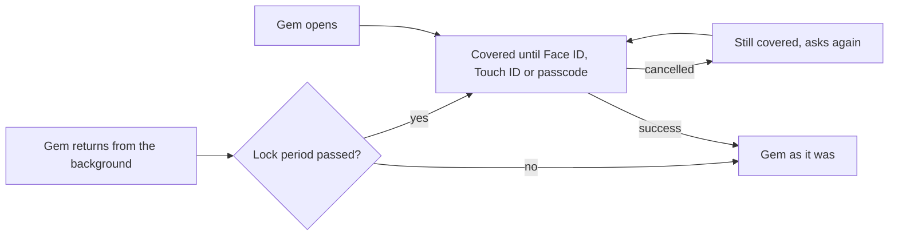
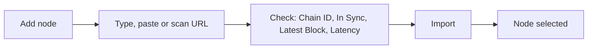

# Settings

Reach the wallets, protect the app, tune currency, language and appearance, choose networks, read about the app, and turn on developer tools.

1. Settings lists Wallets, Security, Notifications, Preferences, WalletConnect, Support, Rewards, About Us and, once turned on, Developer.
2. Preferences: Currency (a searchable list with "Recommended" above "All"), Language, Appearance (System, Light, Dark), Networks, Contacts, and the Perpetuals switch with its default leverage, take profit and stop loss.
3. Security: "Enable Face ID" (or Touch ID, or "Enable Passcode"), then "Require authentication" after Immediately, 1 minute, 5, 15, 1 hour or 6 hours, and Hide Balance.
4. Networks: a Status row with the API, the Stream and each Gem Wallet Node with its latency; per network, the node in use (Gem Wallet Node per region, or one the user added) and the block explorer.
5. Notifications holds one switch for push and a link to Price Alerts; pushes cover the wallet's transactions, its Price Alerts and support replies.
6. About Us: Terms of Services, Privacy Policy, Visit Website, Community links and Version.

## Expected results

| When | Expected | Why |
|---|---|---|
| A currency has no exchange rate | Currency does not offer it | |
| The user picks a currency | every value in the app converts at once | |
| The user opens Language | the system's per-app language setting opens | |
| Hide Balance is turned on | balances are masked everywhere, with no prompt | |
| Gem opens with the lock on | nothing of the wallet shows until the user unlocks | |
| The unlock prompt is open | Gem stays covered behind it | |
| The lock period has passed, whatever the app was doing | the lock re-engages | |
| The user returns before the lock period passes | the app stays unlocked, and the period starts again the next time the user leaves the app | time spent in the app never counts, so a Face ID prompt for a transaction is not followed by an unlock prompt |
| The lock is on and the user opens the app switcher or leaves Gem | Gem is covered in the app switcher | balances and addresses stay hidden from anyone looking at the switcher |
| The user opens Control Center, Notification Center or the notification shade, to change brightness say, and comes back | Gem is covered while it is open and comes back unlocked | that is not leaving Gem; the lock period starts when the user moves to another app or the Home Screen, or the phone locks |
| The lock is on and Gem asks for Face ID, Touch ID, the passcode or notification permission, or to paste | the screen stays as it is, without the cover | the cover is for leaving Gem, not for Gem's own prompts |
| The lock is on and Gem asks for photos or camera access the first time | Gem is covered behind the prompt | these prompts appear once |
| The user opens the app switcher while one of those Gem prompts is open or closing | Gem is covered once the user moves to another app or the Home Screen | Gem cannot tell the switcher from its own prompt closing |
| A WalletConnect request is open when the lock period passes | the lock still re-engages; the request cannot hold it off | |
| The phone is turned or the appearance changes while the unlock prompt is open | the same prompt stays open and unlocks the app | Android recreates the screen; cancelling the prompt then crashed the app |
| The lock is on but the device passcode was turned off | the lock stays and says the device passcode is off and must be turned on to open Gem | the lock relies on the device passcode, so there is nothing else to unlock with |
| Gem opens and the app lock can't be read because the phone's security key changed | "Gem can't unlock on this phone" with Import Wallet and Support; nothing of the wallet shows and the lock is never read as off | the wallets saved on the phone can't be read without that key, while their funds stay safe on their networks |
| The user taps Import Wallet on that screen | "Reset Gem on this phone?" with Reset and Cancel; Reset removes every wallet, setting and key Gem saved on the phone, then onboarding opens at Import Wallet, where the user sets the app lock again | only the wallets' Secret Phrases or private keys bring them back |
| The user turns the push switch on | the app asks the system for permission | |
| A wallet is created or imported, including one that was already on the device | the app offers push right after | |
| A network API does not expose a latest block, such as HyperCore | the node row shows a dash for Latest Block and still measures the API response latency | a missing capability is not a failed node |
| A network's selected node is no longer offered, because an update removed it or the added node is gone | from the next launch the network uses the US Gem Wallet Node and Networks shows it selected | a node the app no longer lists may no longer answer |
| The app has offered push | it asks again no sooner than 30 days later, unless the user turned push off | |
| The user taps a push | the app switches to the wallet the push belongs to, then opens the transaction, the asset or the chat | |
| A newer release exists | "New update available!" at launch, with Update and Skip, and in About Us | |
| The update is required | no Skip | |
| The user closes the update prompt | it counts as Skip | |
| The user skipped a version | that version is not offered again | |
| The user long-presses Version | Developer turns on or off | |
| After the fifth launch | the app asks once for a store review | |

## Platform differences

| When | iOS | Android | Expected |
|---|---|---|---|
| The lock is on and Gem is in the app switcher or behind a system panel | covered with the Gem logo | covered with Gem's background color, without the logo | Intentional: Android saves the switcher preview before Gem can draw a cover and allows only a color in its place, so the cover uses the same color and coming back goes straight from it to the app |
| The device passcode is off while the lock is on | the lock screen explains it in text | the lock screen explains it and opens screen lock setup | Intentional: iOS has no public way to open passcode settings |
| The phone's security key changes under Gem | not applicable | "Gem can't unlock on this phone", then Reset and Import Wallet | Intentional: the failure comes from the Android Keystore, which iOS doesn't use |
| The user opens Developer | includes a deep link URL tool | includes a platform store setting | Intentional (developer-only) |
| The build cannot push (F-Droid, Huawei) | not applicable | Settings does not list Notifications, so neither the push switch nor Price Alerts is reachable | Intentional: the build has no push service |

## Rules

- Nothing is pushed without the user's permission.
