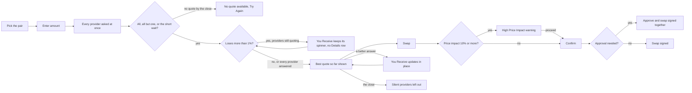
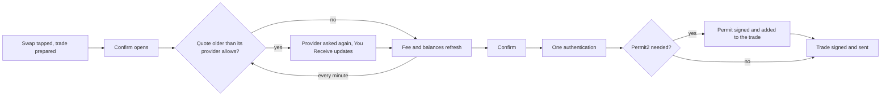

# Swap

Trade one asset for another from inside the wallet, on one network or across two, at the best quote among the providers. The Swap screen prepares the trade; the confirmation screen signs it.

The confirmation screen keeps the quote fresh on its own and asks for the device's authentication once:

1. The user opens Swap from the wallet screen, an asset, or Swap Again on a past swap; the pair is filled in, never the same asset on both sides; when the wallet has no address on the receive asset's network, only the pay side is filled in.
2. The user types an amount or taps 25%, 50% or 100%; every provider that serves the pair is asked at once and You Receive shows the best quote so far, see [Asking the providers](#asking-the-providers).
3. Details lists the Provider, the Rate, the Estimated Time, the Minimum Receive and the Slippage; Providers lets the user pick another provider.
4. Slippage is Auto (`1%`, `3%` on Solana) or a chosen value between `0.1%` and `20%`.
5. Swap prepares the trade with the chosen provider and opens the confirmation screen, which asks that provider again once the quote is old and signs the trade with one authentication.

## Asking the providers

Every provider that serves the pair is asked at once. You Receive shows the best quote so far as soon as one of these holds:

1. every provider has answered;
2. all but one have answered, once at least two have;
3. the short wait after the first quote has passed.

| Pair | Short wait after the first quote | Round closes after the request | A quote lives |
|---|---|---|---|
| Both assets on one network | `0.5 s` | `6 s` | `1 minute` |
| Across networks | `1 s` | `12 s` | `5 minutes`, because a cross-network provider gives a new deposit with every answer |

| When | Expected | Why |
|---|---|---|
| Three of four providers answered and the fourth is still quoting | the best of the three shows, Details shows its rate, and Swap works | one slow provider never holds back the others |
| One of two providers answered | its quote shows after the short wait, unless the other answers first | the wait lets the other answer on a slow connection |
| The first quote arrives | it and its fiat value fade in at their usual places, without moving the row | |
| A better quote arrives while the round is open | You Receive and its fiat value roll to it in place | the best quote wins |
| The best quote so far loses more than `1%` and providers are still quoting | You Receive keeps its spinner and the Details row stays hidden | a thin pool's early quote should not be the first number the user sees |
| A quote within `1%` then arrives | it shows at once, with its rate on Details | |
| The round ends and the best quote still loses more than `1%` | it shows with its Price Impact | the user still decides |
| The pair has no prices | its quotes are never held | there is no Price Impact to compare |
| A provider is still silent when the round closes | it is left out | the round always closes |
| No provider gave a quote by the close | No quote available with Try Again | |
| Providers is opened while the round is open | a row for each provider that answered and a loading row for each one still quoting | |

## Choosing a quote

| When | Expected | Why |
|---|---|---|
| Providers quote different amounts | the quote that gives the most wins | |
| An on-chain provider is within `0.1%` of the best, or within `0.05%` for Orca, Raydium, PumpSwap and Meteora | it wins | no third-party service stands between the wallet and the trade |
| SunSwap is within `1%` of the best | it wins | SUN pays `99%` of the swap's energy, so it costs a fraction of a TRX; another provider's USDT deposit pays its own |
| Several preferred providers are that close | the one that gives the most wins | |
| The user swaps 100% and a provider that leaves nothing behind is within `0.25%` of the best | it wins over all of them | a slightly smaller amount beats a reserve stuck in the wallet |
| A quote gives less than half of the best | it is not shown | such quotes come from nearly empty pools |
| Cetus and DeepBook both quote a Sui pair | the quote that gives the most wins | both run on-chain, so no preference applies |

The on-chain providers are Across, Orca, Raydium, PumpSwap, Meteora, THORChain and SunSwap: each quotes from the chain and sends the trade straight to its own contract.

Uniswap, PancakeSwap, Aerodrome, Raydium and Meteora each show as one provider. Their pool types quote together, and the swap and its approval are built with the pool type that gave the most.

| Provider | Pool types |
|---|---|
| Uniswap | v2 on Ethereum, Robinhood Chain, Base and Polygon, v3, v4 |
| PancakeSwap | v2 on BNB Chain, v3 |
| Raydium | CLMM, CPMM, AMM v4 |
| Meteora | DAMM v2, DLMM |
| Aerodrome | Slipstream, classic volatile and stable pools |

## Swapping the whole balance

Some providers swap whatever arrives at a deposit address, so the network fee simply comes off what is sent. Others run a contract call that spends exactly the amount quoted, so the fee has to be set aside first.

| When the user swaps 100% of a network's coin and | Expected | Why |
|---|---|---|
| the provider swaps whatever arrives: Near Intents except HyperCore, Chainflip from Polkadot, THORChain and Relay from Bitcoin and other non-Ethereum networks | the full balance is quoted and the network fee comes off at signing, so nothing is left behind | a deposit can be any amount |
| what is left after the fee is under that provider's minimum | the minimum is shown, not Insufficient Balance | the provider would reject or refund it |
| the provider needs the exact amount: Uniswap, PancakeSwap, OKX, Jupiter, Orca, Mayan, Across, Bridgers, Stellar DEX, XRP Ledger DEX | Swap quotes the balance less a fee reserve; Confirm then sends everything but the actual network fee and shows that amount | the fee is known only on the confirmation screen |
| that provider is on Solana, TON, Tron, Sui, Aptos, Stellar or the XRP Ledger | the reserve stays in the wallet | those networks charge more than the fee shown: rent, forwarding, energy, a trust line's reserve |
| the provider takes any amount but builds a contract call | it is treated as needing the exact amount | otherwise the fee would not fit |

## Gem fee

Gem takes `0.5%` of every swap and bridge, with these exceptions:

| Swap | Gem fee |
|---|---|
| A stablecoin to another stablecoin on one network, with any provider but OKX and SunSwap | `0.25%` |
| A bridge through Across | `0.25%` |
| Chainflip | `0.45%` |
| OKX | `0.7%` |
| SunSwap | `0.85%`, the most SUN's referral vault accepts; Gem receives half |
| NEAR Intents | `1%` asked, of which Gem receives `0.5%`; NEAR passes the other half to its buyback wallet |

A stablecoin is one on the official list, USDT, USDC, USDS, USDe, USD1, USDG and PYUSD, on its issuer's networks; a token that only carries one of those names pays the full fee. A stablecoin moved to another network pays `0.5%`, or `0.25%` through Across.

## Expected results

### Swap screen

| When | Expected | Why |
|---|---|---|
| Swap opens | a token the wallet does not hold is paid with its network's coin; otherwise the most recently used pair | |
| The user picks the asset already on the other side, or taps the arrow between the two sides | the pair turns around | |
| The user picks an asset, or taps 25%, 50%, 100% or "Use minimum amount" | quotes are asked at once | a button's amount is already final |
| The user types an amount | quotes are asked shortly after typing stops | the amount settles first |
| The screen stays open | quotes refresh every `30 seconds` | |
| A refresh or a new amount is loading, including going back from Confirm | You Receive shows only its spinner and the Details row hides until the new round shows a quote | the last round's amount and rate never sit next to the spinner |
| A refresh while Details is open | Details shows its loading indicator until the new quote, or the error if the refresh fails | it matches You Receive |
| The amount, an asset or the slippage changes | You Receive clears | |
| An answer arrives for an amount or pair the user has already changed | it is thrown away | |
| The user picks another provider | the choice survives refreshes, and a better quote does not replace it | the user's choice wins |
| The user picked a provider and changes the amount, and other providers answer first | You Receive keeps its spinner until the picked provider answers; if it has no quote, the best one shows | Swap never offers another provider's quote in place of the picked one |
| Preparing the chosen quote fails after Swap is tapped | an error alert with the provider's message; the quote, Details and Swap stay, so tapping Swap prepares it again | the quote itself succeeded; Try Again is only for a failed quote |

### Slippage and price impact

| When | Expected | Why |
|---|---|---|
| The price impact is a loss of more than `1%` | Details shows the Price Impact after the rate, on one line, and a long rate shrinks to fit, down to `12` on both apps | the row keeps its height |
| The price impact is `10%` or more | "High Price Impact" asks first | |
| The High Price Impact confirmation is open when the quote refreshes | Confirm trades only the quote the warning named; if another quote took its place, nothing is traded and the new quote shows | the user never trades a quote they were not warned about |
| A chosen Slippage is `3%` or more | a warning | |
| Slippage is Auto, including Solana's `3%` | no warning | |
| The user changes Slippage | the choice is kept for later swaps | |
| Slippage is Auto and the provider is OKX or Chainflip | Minimum Receive uses the most OKX may take, and the slippage Chainflip recommends | the minimum shown is one the trade keeps |
| The user picks a Slippage and the provider is Chainflip | the swap uses that slippage, not Chainflip's recommendation | the chosen limit is the one enforced |

### Confirm

| When | Expected | Why |
|---|---|---|
| Confirm loads or refreshes and the quote is older than it lives | the chosen provider is asked again for the same amount and slippage, Auto staying Auto, and You Receive shows its new answer | a quote left on screen never goes stale, and a cross-network provider is not asked for a new deposit every minute |
| The quote is younger than that | only the fee and balances refresh | |
| A provider answers after the user tapped Swap | the trade does not change | the trade on Confirm is the one the user chose |
| The chosen provider no longer answers | the error row with Retry; the provider is never switched behind the user | |
| The swap needs a spending approval | the approval is signed together with the swap, with one fee for both | |
| The provider needs a Permit2 signature | it is signed at Confirm under the same authentication | nothing is signed before the confirmation screen |
| The user taps Confirm | the trade the screen loaded is signed with one authentication | the amounts signed are the amounts shown |
| Confirm opens | no Provider row; Swap Details, opened from Details, names the provider | the screen keeps to what is signed: wallet, network, amounts and fee |

### Providers

| When | Expected | Why |
|---|---|---|
| A token takes a fee when it moves | it gets no Uniswap or PancakeSwap v2 quote and no Aerodrome classic quote | those quotes assume the pool receives the full amount, so the swap would fail its slippage check |
| A Solana trade between two tokens routes through SOL on PumpSwap, Meteora or Raydium CPMM and AMM v4 | it goes as two swaps in one transaction, and the Minimum Receive still holds | these pools cannot pass one pool's output into the next |
| A wallet's first PumpSwap trade | about `0.0018 SOL` of rent on top of the network fee | it creates the wallet's pump.fun volume account |
| A Solana swap runs out of compute | it fails on chain and the network fee is spent | swaps are sent without the node's own check |
| A Sui pair has no DeepBook pool, such as DEEP to WAL | DeepBook trades it in two pools through SUI or USDC, whichever pays more | |
| The amount is below a DeepBook pool's smallest trade, such as 1 SUI to USDC | no DeepBook quote; if no other provider quotes, the minimum to pay shows, Gem's fee included | the pool would hand the coins back unswapped |
| DeepBook would leave more than `1%` of the amount unfilled | no DeepBook quote | the book trades whole lots |
| A DeDust swap on TON | Gem's `0.5%` fee goes as a second message in the same transaction; if DeDust rejects the swap on slippage, the amount comes back but the fee stays paid | DeDust has no fee field, and TON runs the messages independently |
| A STON.fi swap | it must reach its pool within `15 minutes` of Confirm preparing it; a two-pool swap holds each pool to its own minimum | a user who reads Confirm first is not refunded |
| A SunSwap swap on Tron | the Network Fee is the user's share of the energy | SUN pays `99%` of the energy |
| A token is swapped through SunSwap | the first time, an approval for SUN's Permit2; then a Permit2 signature at Confirm whenever the last one has run out | |
| An Aero token swap | it approves Aero's Metarouter directly, with no Permit2 | |
| A Stellar DEX swap | one transaction: a trustline when the wallet has none, the path payment, then Gem's fee; it expires `15 minutes` after Confirm prepared it | a swap stuck behind higher fees expires instead of trading late |
| A Stellar pair has neither XLM nor Circle's USDC on either side | no Stellar DEX quote | Gem's fee account receives only XLM and USDC |
| A Stellar DEX swap of 100% of XLM | `0.55 XLM` stays back | a trustline locks `0.5 XLM` of reserve |
| An XRP Ledger DEX swap | one Batch, all or none: a trust line when the wallet has none, the payment, then Gem's fee | |
| An XRP Ledger pair is USDC to RLUSD | no quote | Gem's fee account holds only XRP and RLUSD |
| An XRP Ledger DEX swap of 100% of XRP | `0.25 XRP` stays back | a new trust line holds `0.2 XRP` of reserve |
| The ledger accepts the Batch but its swap failed | the swap shows Failed, and only the network fee is spent | the ledger reports the Batch as successful either way |
| A Stellar or XRP Ledger DEX swap in History | one Swap with Gem's fee, not separate payments | |
| An Across bridge | what arrives is the amount less the LP, relayer capital and relayer gas fees, all in the token bridged; a deposit no relayer fills is refunded after `2 hours` | |
| THORChain or Maya halts or resumes a network | it can show up to `15 minutes` late | |
| Near Intents with HyperCore | HyperCore spot USDC can be paid but not received | the provider pays HyperCore USDC into perps, apart from the wallet's spot balance |

## Contract binding

A provider may only move funds into contracts the app ships for it. Before Confirm signs, the app checks the transaction against that list: on EVM and Tron the contract called and every spender, on Solana every instruction's program, on TON every message. Standard Solana programs pass but may not approve a delegate, change an authority or reassign an account; the Solana check stops at the program, so where a transfer inside a standard program pays is not yet bound. A provider that names anything else is refused at Confirm, and left out of the quote list where its quote already names the contract. When a provider upgrades a contract, its swaps stop until the app update that ships the new address.

| Provider | Network | Bound to | Checked |
|---|---|---|---|
| THORChain, Maya | EVM token deposit | The router | In the quote list and at Confirm |
| THORChain, Maya | Coin deposit | Not bound: the vault rotates | |
| OKX | EVM | The router, and its approval contract as the only spender | At Confirm |
| OKX | Solana | Its program | At Confirm |
| Relay | EVM | Its deposit contract, approval proxies and routers; only the deposit contract and approval proxies as spenders | In the quote list and at Confirm |
| Relay | Tron, TON | Its depository | In the quote list and at Confirm |
| Relay | Solana | Its depository and forwarder programs, and Jupiter's | At Confirm |
| Chainflip | EVM, Tron, Solana | The vault, exactly the amount and token quoted, the asset, network and address the swap pays out to, and the refund address and minimum price | At Confirm |
| Mayan | EVM | The forwarder | At Confirm |
| Mayan | Solana | Its programs, and Jupiter's | At Confirm |
| Bridgers | EVM, TON coin | The router | At Confirm |
| Jupiter, Orca, Raydium, PumpSwap, Meteora | Solana | Their programs | At Confirm |
| Aero | EVM | The Metarouter | At Confirm |
| Relay, Chainflip, Near Intents, swaps.xyz | Bitcoin and other deposit-address swaps | Not bound: a deposit address made per swap | |
| Mayan on Sui; Bridgers for TON tokens and XRP | | Not bound | |
| DeDust, STON.fi | TON tokens | Not bound: the sender's own jetton wallet, which comes from the TON node | |
| Uniswap family, Across, SunSwap, STON.fi, DeDust, Hyperion, Cetus, DeepBook, Hyperliquid, Stellar DEX, XRP Ledger DEX | All | Built on the device against shipped contracts | |

A known contract shows under its provider's name, such as `SunSwap Router`; the shared Uniswap Permit2 shows as `Permit2`.

## Platform differences

None recorded.

## Rules

- Regional restrictions follow the shared [Feature availability](../PRODUCT.md#feature-availability) table.
- A quote is never cached: every provider is asked again for the live amount, priced on live chain state; only facts that never change, such as a pool's address and tokens, are kept.
- A slow provider never holds back a quote another provider already gave.
- Swap never signs anything: the confirmation screen holds the only authentication and signs the trade it showed.
- The Slippage row reads Auto on both screens until the user picks a value.
- A swap only calls, and only approves, contracts the app ships for that provider and network ([Contract binding](#contract-binding)).
