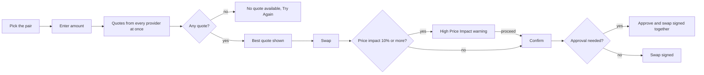
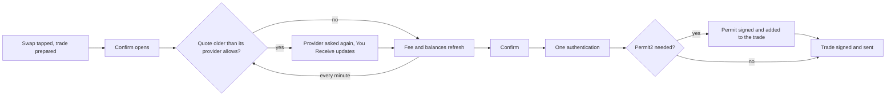
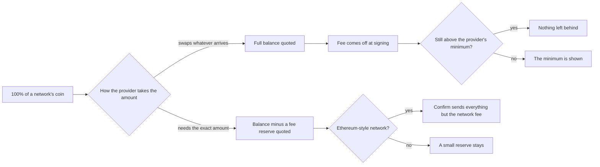
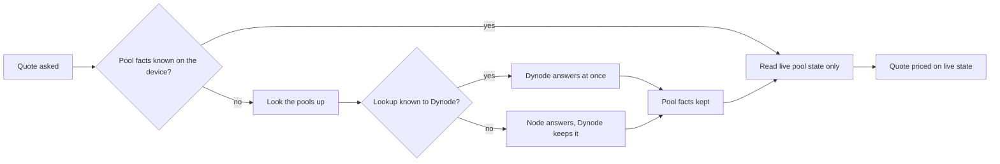

# Swap

Trade one asset for another from inside the wallet, on one network or across two, at the best quote among the providers. The Swap screen prepares the trade; the confirmation screen signs it.

The confirmation screen keeps the quote fresh on its own and asks for the device's authentication once:

A quote lives `1 minute` when the swap stays on one network and `5 minutes` when it crosses networks, because a cross-network provider gives a new deposit with every answer.

1. The user opens Swap from the wallet screen, an asset, or Swap Again on a past swap; the pair is filled in, never the same asset on both sides.
2. The user types an amount or taps 25%, 50% or 100%; every provider that serves the pair is asked at once and You Receive shows the best quote.
3. Details lists the Provider, the Rate, the Estimated Time, the Minimum Receive and the Slippage; Providers lets the user pick another provider.
4. Slippage is Auto (`1%`, `3%` on Solana) or a chosen value between `0.1%` and `20%`.
5. Swap prepares the trade with the chosen provider and opens the confirmation screen, which asks that provider again once the quote is old and signs the trade with one authentication.

## Swapping the whole balance

Providers take an amount in one of two ways. Some swap whatever arrives at a deposit address, so they can take the full balance and the network fee simply comes off what is sent. Others run a contract call that spends exactly the amount quoted, so the fee has to be set aside before the quote.

| When the user swaps 100% of a network's coin and | Expected | Why |
|---|---|---|
| the provider swaps whatever arrives: Near Intents except HyperCore, Chainflip from Polkadot, Thorchain and Relay from Bitcoin and other non-Ethereum networks | the full balance is quoted; the network fee comes off when the transaction is signed, so nothing is left behind | a deposit can be any amount |
| what is left after the fee is under that provider's minimum | the minimum is shown, not a balance error | the provider would reject or refund it |
| the provider needs the exact amount: Uniswap, PancakeSwap, OKX, Jupiter, Orca, Squid, Mayan, Across, Bridgers | Swap quotes the balance minus a fee reserve, so the quote is close; the confirmation screen then asks for everything but the actual network fee and shows that amount | the reserve is a guess; the fee is known only on the confirmation screen |
| that provider is used on Solana, TON, Tron, Sui or Aptos | the reserve stays in the wallet | those networks charge more than the fee shown: rent, forwarding, energy |
| the provider says it can take any amount but builds a contract call | it is treated as needing the exact amount | otherwise the full balance would be quoted and the fee would not fit |
| a provider that leaves nothing behind quotes within `0.25%` of the best quote | that provider is chosen | a slightly smaller amount received beats a reserve stuck in the wallet |

## Choosing a quote

The quote that gives the most wins. A provider that runs on-chain, with no third-party service between the wallet and the trade, wins instead when its quote is within `0.1%` of the best. When more than one of them is that close, the one that gives the most wins. For a 100% swap, a provider that leaves nothing behind within `0.25%` still comes before all of them.

| Provider | Runs on-chain because |
|---|---|
| Across | the deposit goes straight to its SpokePool contract on the paying network and settles in seconds |
| Orca | the quote is read from the Whirlpool accounts and the swap goes straight to the pool |
| Raydium | the quote is read from the CLMM pool accounts and the swap goes straight to the pool |
| THORChain | the quote comes from THORChain's own node and the deposit goes straight to its vault |

## On-chain quotes

Uniswap v3 and v4, PancakeSwap, Aerodrome, Oku, Wagmi, Orca, Raydium, Cetus, STON.fi and Hyperion quote straight from the chain. What a pool is never changes once it exists: its address, its tokens, its fee tier. What it holds changes with every trade: its price, liquidity and reserves. The wallet keeps the first and reads the second again for every quote, so a quote is always priced on live state while the lookups that never change are not repeated. Dynode, the node proxy every wallet talks to, keeps the same unchanging lookups for all users ([how Dynode caches](../DYNODE.md#caching)).

| On the device | Kept for |
|---|---|
| A pool exists: its address, tokens and fee tier, and the version Cetus needs to trade with it | `7 days` |
| No pool exists at a fee tier | `1 day` |
| A pool cannot trade: no liquidity at its price, or swaps paused or not open yet on Orca and Raydium, or locked on STON.fi | `1 hour`, then it is checked again |
| A pool or route that gave more than `3%` less than the best, or failed while another succeeded | `5 minutes`, skipped only when the same pair is quoted for the same amount |
| On Solana: the token mints, Gem's fee accounts and Raydium's fee configs | `1 day` |
| Cetus's four main SUI/USDC pools | always; they ship with the app |

| On Dynode | Kept for |
|---|---|
| Uniswap v3, PancakeSwap, Aerodrome, Oku and Wagmi pool lookups | `1 day` |
| Uniswap v4 pool lookups | `1 day` |
| Cetus pool lookups | `1 day` |
| STON.fi pool and jetton wallet addresses | `30 days` |
| Sui epoch and gas price | `10 minutes` |

Anything not listed is read again for every quote.

Solana, Uniswap v4 and Hyperion pool addresses are computed on the device from the two tokens and the fee tier, so finding a pool only checks that it exists. On Solana a quote reads every account it needs in one request. Orca and Raydium each look up their `8` most-used fee tiers, which hold about `92%` and `94%` of the liquidity in their 200 largest pools. With 8 tiers, a token-to-token pair needs at most `93` accounts, which fits Solana's `100`-account limit, so a quote never splits into a second request.

### Skipping pools that lose

Every quote compares candidates and keeps the best. A candidate that gave more than `3%` less than the best, or that failed while another succeeded, is not asked again for the next `5 minutes` when the same pair is quoted for the same amount, as the 30-second refresh and the confirmation screen do. Any other amount asks every candidate again: a pool too shallow for a large trade can still be the best for a small one, and a deep pool that lost to a small pool's better price can win a larger trade. Failing means the quote reverted, the pool ran out of liquidity for the amount, or the pool could not pay the output; a network error never counts. When every candidate fails or gives nothing, as for a dust amount, none is marked. If every candidate still asked fails, the skipped ones are asked before the quote fails (`test_outpriced_cache`, `test_get_best_quote_skips_outpriced_paths`, `test_route_failing_alone_is_asked_again`, `test_find_route_skips_outpriced_pools`).

| Provider | Candidates |
|---|---|
| Uniswap v3 and v4, PancakeSwap, Aerodrome, Oku, Wagmi | each path: one pool at a fee tier, or two pools through a base token |
| Orca, Raydium | each route: one pool, or two pools through an intermediate token; a skipped pool's accounts are left out of the request |
| STON.fi | each path, and each pool within a hop |
| Hyperion | each path, and each pool within a hop |

Cetus prices all its pools in one dry run, so it has nothing to skip. `3%` keeps close rivals: two fee tiers on a busy pair are often within `1%` and trade places as prices move, so both stay. In the measured pairs, every pool that lost was `6%` to `99%` worse than the best, or failed.

### Requests per quote

Measured on 2026-10-17, one pair per provider and the same amount, on the build before and after this caching. Each count is HTTP requests; a single number did not change, and `before → after` shows what did. "A day later" is the same pair quoted again while the app is still open: before this caching, pool facts expired after `1 day` and discovery ran again; by then the losing pools are asked again too, so it costs what the repeat quote cost before skipping, as does a quote for a new amount. Everything the device keeps lives in memory, so after the app restarts the first quote pays the full cost again, and Dynode's lookups make that fast. Size is the repeat quote's response before compression. A swap build of `0` is built without a request; Cetus's was measured with an empty test wallet, so its dry run failed.

| Provider and pair | First quote | Repeat quote | A day later | Swap build | Size |
|---|---|---|---|---|---|
| Uniswap v3, ETH to USDC | 2 | 1, with 8 → 7 calls | 2 → 1 | 0 | 4 KB |
| Uniswap v4, ETH to USDC | 2, with 16 → 8 calls | 1, with 4 → 3 calls | 2 → 1 | 0 | under 1 KB |
| Orca, SOL to USDC | 2 | 1 | 2 → 1 | 1 | 318 → 234 KB |
| Raydium, SOL to USDC | 2 | 1 | 2 → 1 | 1 | 335 → 229 KB |
| Orca, JUP to USDC | 2 | 2 → 1 | 2 → 1 | 1 | 337 → 213 KB |
| Raydium, JUP to USDC | 2 | 2 → 1 | 2 → 1 | 1 | 193 → 127 KB |
| Cetus, SUI to USDC | 7 | 1 | 7 → 1 | 6 | 3 KB |
| STON.fi, TON to USDT | 10 | 4 → 2 | 10 → 4 | 0 | 2 → 1 KB |
| Hyperion, APT to USDC | 19 → 13 | 7 → 2 | 19 → 7 | 3 | under 1 KB |

A repeat quote took about `110 ms` to `130 ms` on Ethereum and Sui, most of it the round trip to Dynode. Solana's carry 130 to 230 KB of pool accounts and took `170 ms` to `800 ms`. STON.fi and Hyperion ask one pool per request, so their repeat quotes took about `230 ms` and `270 ms`.

## Expected results

| When | Expected | Why |
|---|---|---|
| Swap opens | a token the wallet does not hold is paid with its network's coin; otherwise the most recently used pair | |
| The user picks the asset already on the other side, or taps the arrow between the two sides | the pair turns around | |
| The user picks an asset | quotes are asked at once | |
| The user types an amount | quotes are asked shortly after typing stops | |
| The screen stays open | quotes refresh every `30 seconds` | |
| A refresh, including going back from Confirm | You Receive shows only the loading indicator until the new quote arrives, never the old amount with it | |
| A refresh while Details is open | Details shows the loading indicator until the new quote arrives, never the old quote's details | it matches You Receive |
| A refresh fails while Details is open | Details stays open and shows the error, as the Swap screen does | |
| The selected quote's `get_quote_data` call fails | an error alert; the quote, Details and the Swap button stay, so tapping Swap prepares it again, with no inline error row and no Try Again | quote fetching succeeded; only the later transaction-data preparation failed, and Try Again belongs to a failed quote |
| The amount, an asset or the slippage changes | You Receive clears | |
| An answer arrives for an amount or pair the user has already changed | it is thrown away | |
| The price impact is a loss of more than `1%` | Details shows the Price Impact | |
| The user picks another provider | the choice survives refreshes | |
| A chosen Slippage is `3%` or more | a warning | |
| Slippage is Auto, including Solana's `3%` | no warning | |
| Slippage is Auto and the provider picks its own: OKX, Squid | Minimum Receive is priced with the most OKX may take, and with the slippage Squid picked | the minimum shown is one the trade keeps |
| The user changes Slippage | the choice is kept for later swaps | |
| The price impact is `10%` or more | "High Price Impact" asks first | |
| The swap needs a spending approval | the approval is signed together with the swap, with one fee for both | |
| The confirmation screen loads or refreshes and the quote on screen is older than `1 minute` on one network, or `5 minutes` across networks | the chosen provider is asked again for the same amount and slippage, Auto staying Auto, and You Receive shows its new answer | a quote left on the screen never goes stale, and a cross-network provider is not asked for a new deposit every minute |
| The quote is younger than that | it stays; only the fee and balances are refreshed | |
| The chosen provider no longer answers | the error row with Retry; the provider is never switched behind the user | |
| The user taps Confirm | the trade the screen loaded is signed with one authentication | the amounts signed are the amounts shown |
| The provider needs a Permit2 signature | it is signed at Confirm together with the swap, under that same authentication | nothing is signed before the confirmation screen |
| The confirmation screen opens | no Provider row; the provider is named in Swap Details, opened from Details | the screen keeps to what is signed: wallet, network, amounts and fee |
| A provider's minimum is then above that amount | the user is told the minimum, not "insufficient balance" | |
| The user taps 25%, 50% or 100%, or "Use minimum amount" | quotes are asked at once | typing waits a short pause for the amount to settle; a button's amount is already final |

## Rules

- Regional restrictions follow the shared [Feature availability](../PRODUCT.md#feature-availability) table.
- A quote is never cached: every eligible provider is asked again for the live amount, and every quote is priced on live chain state. Only the facts that never change are kept, and for `5 minutes` which pools lost at that exact amount, as [On-chain quotes](#on-chain-quotes) lists.
- Every eligible provider is awaited, so the slowest one decides how long a quote takes.
- Swap never signs anything: the confirmation screen holds the only authentication and signs the trade it loaded and showed.
- The Slippage row reads Auto on both screens until the user picks a value.
- DeDust has no fee field, so the `0.5%` fee is taken from the amount paid and sent as a second message in the same wallet transaction (`test_native_messages`, `test_jetton_messages`). TON runs the two messages independently: when DeDust rejects the swap because the price moved past the slippage limit, the swap amount comes back but the fee stays paid. The swap carries no deadline, so time spent on the confirmation screen cannot get it rejected.
- Near Intents serves HyperCore spot USDC as a source only. HyperCore destinations are excluded because the provider pays USDC into perps, which is separate from the wallet's spot asset (`test_supports_destination`). HyperCore deposits use an exact input quote and send its returned input amount from spot with `sendAsset`, since unified accounts reject `spotSend`; the provider deducts its deposit fee from that amount (`test_swap_type`, `test_hypercore_quote_data`).
