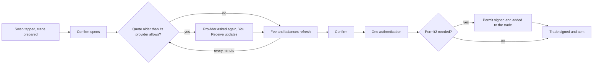
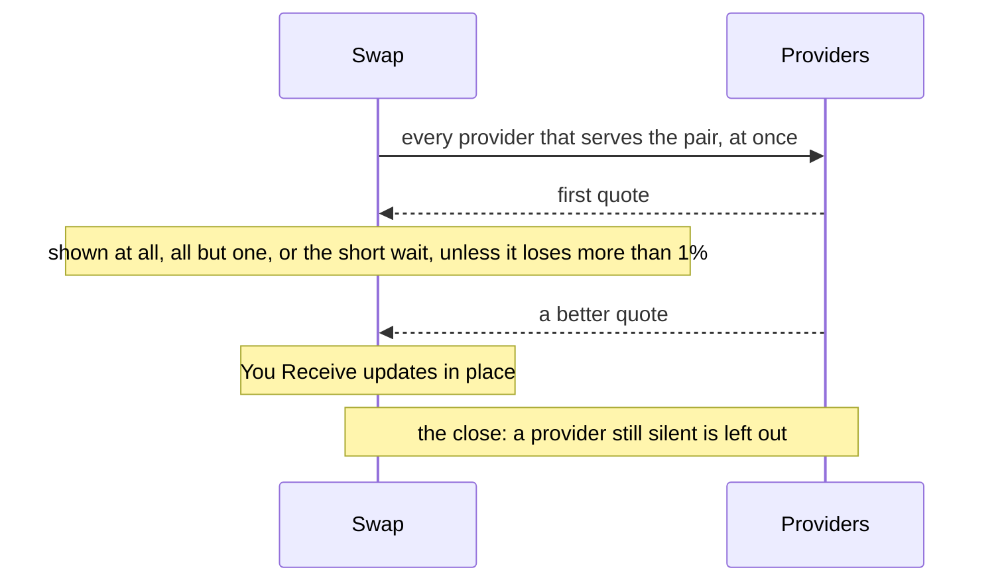
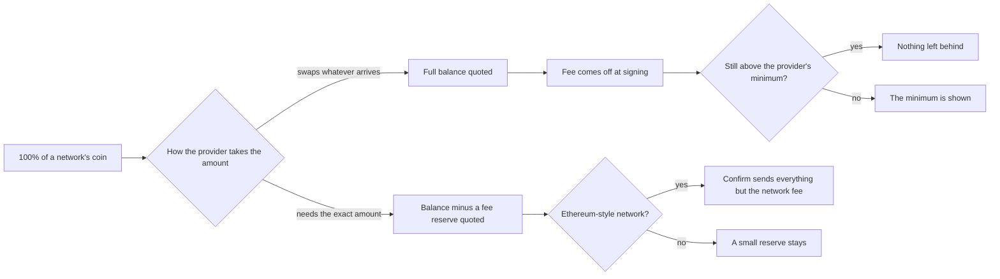
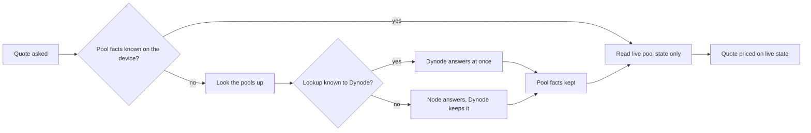

# Swap

Trade one asset for another from inside the wallet, on one network or across two, at the best quote among the providers. The Swap screen prepares the trade; the confirmation screen signs it.

The confirmation screen keeps the quote fresh on its own and asks for the device's authentication once:

A quote lives `1 minute` when the swap stays on one network and `5 minutes` when it crosses networks, because a cross-network provider gives a new deposit with every answer.

1. The user opens Swap from the wallet screen, an asset, or Swap Again on a past swap; the pair is filled in, never the same asset on both sides.
2. The user types an amount or taps 25%, 50% or 100%; every provider that serves the pair is asked at once and You Receive shows the best quote so far, see [Asking the providers](#asking-the-providers).
3. Details lists the Provider, the Rate, the Estimated Time, the Minimum Receive and the Slippage; Providers lets the user pick another provider.
4. Slippage is Auto (`1%`, `3%` on Solana) or a chosen value between `0.1%` and `20%`.
5. Swap prepares the trade with the chosen provider and opens the confirmation screen, which asks that provider again once the quote is old and signs the trade with one authentication.

## Asking the providers

Every provider that serves the pair is asked at once, and a slow one never holds back the others. You Receive shows the first quote as soon as one of these holds:

1. every provider has answered;
2. all but one have answered, counting only once at least two have;
3. a short wait after the first quote has passed.

So one provider shows when it answers, two show when both have answered or the wait has passed, four show at the third answer, and Solana's six on one network, Jupiter, Orca, Raydium, PumpSwap, Meteora and OKX, show at the fifth.

| Pair | Short wait after the first quote | Round closes after the request |
|---|---|---|
| Both assets on one network | `0.5 s` | `6 s` |
| Across networks | `1 s` | `12 s` |

The short wait counts from the first quote, so a slow connection still gets every answer; the long close leaves room for slow connections and slow providers. While the round is open, the Details row shows a small spinner and how many providers answered of those asked, as `3/4`, before the rate, Swap works, and Providers lists each provider that answered and a loading row for each one still quoting. You Receive's spinner sits at the start of the row, centered on its height; the first quote and its fiat value fade in at their usual places over it, without moving, and a better quote then rolls You Receive and its fiat value to the new amount, ranked as in [Choosing a quote](#choosing-a-quote). When the round closes, a provider still silent is left out and the spinner and `3/4` fade out; with no quote at all, No quote available shows with Try Again.

A quote that loses more than `1%` against the market price, the point where Details starts showing the Price Impact, is not shown early: You Receive keeps its spinner and the Details row shows only the spinner and `2/4`, with no rate, until a provider gives a quote within `1%` or the round ends. Tapping it opens Providers with the quotes so far, and a provider the user picks there shows at once. When every provider has answered or the round closes, the best quote shows with its Price Impact, and the `10%` High Price Impact confirmation still asks first. A pair without prices has no Price Impact, so its quotes are never held.

All of these numbers live in one place, the quote round settings next to the High Price Impact threshold, so they can be tuned together.

## Swapping the whole balance

Providers take an amount in one of two ways. Some swap whatever arrives at a deposit address, so they can take the full balance and the network fee simply comes off what is sent. Others run a contract call that spends exactly the amount quoted, so the fee has to be set aside before the quote.

| When the user swaps 100% of a network's coin and | Expected | Why |
|---|---|---|
| the provider swaps whatever arrives: Near Intents except HyperCore, Chainflip from Polkadot, Thorchain and Relay from Bitcoin and other non-Ethereum networks | the full balance is quoted; the network fee comes off when the transaction is signed, so nothing is left behind | a deposit can be any amount |
| what is left after the fee is under that provider's minimum | the minimum is shown, not a balance error | the provider would reject or refund it |
| the provider needs the exact amount: Uniswap, PancakeSwap, OKX, Jupiter, Orca, Squid, Mayan, Across, Bridgers | Swap quotes the balance minus a fee reserve, so the quote is close; the confirmation screen then asks for everything but the actual network fee and shows that amount | the reserve is a guess; the fee is known only on the confirmation screen |
| that provider is used on Solana, TON, Tron, Sui or Aptos | the reserve stays in the wallet | those networks charge more than the fee shown: rent, forwarding, energy |
| the provider says it can take any amount but builds a contract call | it is treated as needing the exact amount | otherwise the full balance would be quoted and the fee would not fit |
| a provider that leaves nothing behind quotes within `0.25%` of the best quote | that provider is chosen | a slightly smaller amount received beats a reserve stuck in the wallet |

## Choosing a quote

The quote that gives the most wins. A provider that runs on-chain, with no third-party service between the wallet and the trade, wins instead when its quote is within `0.1%` of the best, or within `0.05%` for the Solana pools: Orca, Raydium, PumpSwap and Meteora (`test_solana_pools_are_preferred_within_5_bps_of_the_best_quote`). SunSwap wins within `1%`: SUN pays `99%` of the energy of a swap through its router, so it costs the user a fraction of a TRX, while a USDT deposit to another provider pays its own energy (`test_sunswap_is_preferred_within_100_bps_of_the_best_quote`). When more than one of them is that close, the one that gives the most wins. For a 100% swap, a provider that leaves nothing behind within `0.25%` still comes before all of them.

A quote that gives less than half of the best one is not shown. Quotes that far behind come from nearly empty pools: in 82 pairs quoted with every provider on 2026-10-18, `30` of the `118` quotes that lost were more than half behind and `18` of those more than `90%` behind, while three-quarters of the rest were within `3%` (`test_quotes_giving_less_than_half_of_the_best_are_dropped`).

| Provider | Runs on-chain because |
|---|---|
| Across | the deposit goes straight to its SpokePool contract on the paying network and settles in seconds |
| Orca | the quote is read from the Whirlpool accounts and the swap goes straight to the pool |
| Raydium | the quote is read from the CLMM, CPMM or AMM v4 pool accounts and the swap goes straight to the pool |
| PumpSwap | the quote is read from the pool, its token vaults and pump.fun's fee schedule, and the swap goes straight to the pool |
| Meteora | the quote is read from the DAMM v2 pool account or the DLMM pair and its bins, and the swap goes straight to the pool |
| THORChain | the quote comes from THORChain's own node and the deposit goes straight to its vault |
| SunSwap | the quote is read from SunSwap's v3 pools and the swap goes straight to SUN's router |

Uniswap, PancakeSwap, Aerodrome, Raydium and Meteora each show as one provider. A provider like this asks its pool types at the same time, keeps the quote that gives the most, and builds the swap with the pool type that gave it, so Uniswap v2, v3 and v4 compete inside one Uniswap row and the approval comes from the version that quoted (`test_group_quotes_best_member_and_builds_with_it`, `test_grouped_providers_build_with_the_member_that_quoted`).

| Provider | Pool types |
|---|---|
| Uniswap | v2 on Ethereum, Robinhood Chain, Base and Polygon, v3, v4 |
| PancakeSwap | v2 on BNB Chain, v3 |
| Raydium | CLMM, CPMM, AMM v4 |
| Meteora | DAMM v2, DLMM |
| Aerodrome | Slipstream, classic volatile and stable pools |

## Gem fee

Gem takes `0.5%` of every swap and bridge, with these exceptions:

| Swap | Gem fee |
|---|---|
| A stablecoin to another stablecoin on one network | `0.25%` |
| A bridge through Across | `0.25%` |
| Chainflip | `0.45%` |
| OKX | `0.7%` |
| SunSwap | `0.85%`, of which Gem receives half, see [SunSwap on Tron](#sunswap-on-tron) |

The stablecoin rate applies to every provider that swaps on one network: Uniswap, PancakeSwap, Aerodrome, Oku, Wagmi, Orca, Raydium, PumpSwap, Meteora, Cetus, STON.fi, DeDust, Hyperion and Jupiter; OKX keeps `0.7%`. A stablecoin is a token on the official list: USDT, USDC, USDS, USDe, USD1, USDG and PYUSD, on the networks their issuers deploy them to; a token that only carries one of those names pays the full fee (`test_on_chain_referral_fees`). On a stablecoin pair the pool's own fee is about `0.01%`, so Gem's fee is nearly the whole cost: on 2026-10-19, 10,000 USDT to USDC on Ethereum received `9,963.03` USDC at `0.25%`, against `9,937.99` at `0.5%`. A stablecoin moved to another network pays `0.5%` like any cross-chain swap, unless it goes through Across.

NEAR Intents gives half of every app fee to NEAR's buyback wallet: its docs set a 50/50 split for partners with an API key, with NEAR keeping at least `0.2%`, or `0.01%` on stablecoin and same-asset routes. So the wallet asks NEAR for `1%`, Gem receives `0.5%` and NEAR's buyback wallet `0.5%`. On 2026-10-19 a quote with no app fee for 1 ETH to SOL paid NEAR `0.2%`; a `0.5%` app fee showed in NEAR's explorer as `0.25%` to Gem and `0.25%` to the buyback wallet, and a `1%` app fee as `0.5%` to each. Until 2026-10-19 the wallet asked for `0.5%`, so Gem received `0.25%` from NEAR Intents.

## On-chain quotes

Uniswap v2, v3 and v4, PancakeSwap v2 and v3, Aerodrome, Oku, Wagmi, Orca, Raydium, PumpSwap, Meteora, Cetus, STON.fi, DeDust, Hyperion and SunSwap quote straight from the chain. What a pool is never changes once it exists: its address, its tokens, its fee tier. What it holds changes with every trade: its price, liquidity and reserves. The wallet keeps the first and reads the second again for every quote, so a quote is always priced on live state while the lookups that never change are not repeated. Dynode, the node proxy every wallet talks to, keeps the same unchanging lookups for all users ([how Dynode caches](../DYNODE.md#caching)).

| On the device | Kept for |
|---|---|
| A pool, a Uniswap or PancakeSwap v2 pair, or an Aerodrome classic pool exists: its address, tokens and fee tier, and the version Cetus needs to trade with it | `7 days` |
| DeDust pool and vault addresses | `7 days` |
| The Meteora DAMM v2 and DLMM, Raydium CPMM and Raydium AMM v4 pools found for a pair | `1 day`; Dynode keeps the lookup a day too, so a drained pool or a new one is noticed within about two days |
| No pool exists at a fee tier, no v2 pair exists for two tokens, or Meteora has none for a pair | `1 day` |
| Whether a token takes a fee when it moves, from its [v2](#uniswap-and-pancakeswap-v2) or [Aerodrome classic](#aerodrome) check | `1 day` |
| A pool with no liquidity at its price | `1 hour`, then it is checked again |
| An Orca or Raydium pool with swaps paused or not open yet | `1 hour`, then it is checked again |
| A PumpSwap pool for a cashback coin | `1 hour`, then it is checked again |
| A Meteora pool that is disabled | `1 hour`, then it is checked again |
| A STON.fi pool that is locked | `1 hour`, then it is checked again |
| A DeDust stable pool that was never deployed | `1 hour`, then it is checked again |
| A pool or route that gave more than `3%` less than the best, or failed while another succeeded | `5 minutes`, skipped only when the same pair is quoted for the same amount |
| On Solana: the token mints, Gem's fee accounts, Raydium's fee configs and pump.fun's fee schedule | `1 day` |
| Cetus's four main SUI/USDC pools | always; they ship with the app |

| On Dynode | Kept for |
|---|---|
| Uniswap v3, PancakeSwap, Aerodrome Slipstream and classic, Oku and Wagmi pool lookups | `1 day` |
| Uniswap v4 pool lookups | `1 day` |
| Cetus pool lookups | `1 day` |
| SunSwap pool lookups | `1 day` |
| The Meteora DAMM v2 and DLMM, Raydium CPMM and Raydium AMM v4 pools for a pair | `1 day` |
| STON.fi and DeDust pool, vault and jetton wallet addresses | `30 days` |
| Sui epoch and gas price | `10 minutes` |
| Across rate models | `1 hour` |
| Chainlink prices that convert Across's gas fee | `1 minute` |

Anything not listed is read again for every quote.

Cetus looks up `12` tick spacings, `1`, `2`, `10`, `20`, `40`, `60`, `80`, `120`, `160`, `200`, `220` and `260`, at the same time on a pair's first quote. They hold more than `99.99%` of the liquidity in Cetus's 3,000 largest pools on 2026-10-18; the other five tiers in its config, `4`, `6`, `8`, `30` and `100`, hold almost none, so leaving them out saves five lookups per pair. Every quote ranks its direct pools and its routes through SUI or USDC by what they pay alone. On 2026-10-18, 1,000 USDC to suiUSDT was priced at `1.0012` suiUSDT per USDC through the tick spacing `1` pool, against `1.00003` before, and 10,000 USDC, which used to route through SUI for `3,731` suiUSDT, received `9,962`. 100,000 BRAT to POP routes its first hop through the `0.6%` pool at tick spacing `120` and receives `2.1%` more than through the `1%` pool, matching Cetus's own aggregator.

Solana, Uniswap v4, v2 pair and Hyperion pool addresses are computed on the device from the two tokens and the fee tier, so finding a pool only checks that it exists. On Solana a quote reads every account it needs in one request, which always stays under Solana's `100`-account limit. Orca looks up its `9` most-traded fee tiers, adaptive-fee tiers included, which carried about `97%` of the trading volume of its 3,000 largest pools on 2026-10-18; tier `1028` holds the deep USDC/XAUt0 pool (`test_addresses`). Raydium looks up its `8` most-used fee tiers, which hold about `94%` of the liquidity in its 200 largest pools. A token-to-token pair checks the pair directly and through SOL and USDC at every tier. Orca's first quote asks `50` accounts, then `47` for the pools it found; a repeat quote asks `93`, or at most `97` once the day-long mints and fee accounts are read again, because only adaptive-fee pools need their fee oracle (`test_quote_requests_stay_under_the_account_limit`); Raydium's asks at most `93`. PumpSwap looks up the one pool pump.fun creates when a coin graduates, against SOL or USDC, and trades it directly or through SOL; its fee depends on the coin's market cap, read from the same request.

Uniswap v3 and v4, PancakeSwap, Aerodrome, Oku and Wagmi route through a base token by pairing any fee tier on the first pool with any fee tier on the second, among the pools that exist, and the swap is built with each pool's own tier (`test_two_hop_routes_keep_each_hop_fee_tier`). A token traded against USDC can then go through its `0.3%` pool against ETH and ETH's `0.01%` pool against USDC: on 2026-10-18, 1 billion PEPE to USDC on Ethereum received `11.7` basis points more than the best route that used one tier for both pools. Every combination is quoted in the same single request, so once the pools are known the quote still takes about `0.2 s`.

A Meteora DAMM v2 pool address depends on a config the pool does not store, so it cannot be computed from the two tokens. On a pair's first quote, the wallet asks the node for the program's pools that hold both tokens, once per token order, as two requests sent at the same time: the public Solana node refuses program lookups sent as one batch. Dynode sends program lookups to a node that answers them in about `60 ms` to `200 ms`, and keeps each answer for a day for every wallet, so a lookup any wallet made that day comes back in about `95 ms`. The wallet asks again once its own copy is a day old, so a day later the first quote makes the two lookups again. Each lookup returns only the pool addresses and each pool's liquidity, which is the same whichever way the pair is traded, so buying and selling a token ask the same two lookups. The wallet keeps the `4` pools with the most liquidity: SOL/USDC alone has `463` pools, most of them empty. A Meteora pool carries its whole fee schedule, so a quote then reads only those pools, the mints and the clock, in one request, and trades the best one directly or through SOL.

A Raydium AMM v4 pool address depends on the order book market it was created with, so its pools are found the same way, once per token order, and the `4` with the largest LP supply are kept: LP supply is the only depth the pool account holds, and it always ranks a pair's main pool first. A quote reads each pool and its two token vaults, and the swap goes to the pool with the 8-account instruction that skips the order book. A pair's first quote reads the pools before it knows their vaults, so it takes one more request than a repeat quote.

A Raydium CPMM pool can live at any address its creator signs for, so its pools are found the same way; the program stores the two tokens in byte order, so one lookup per pair finds them all. A quote reads each pool, its fee config, kept for a day, and its two vaults, and prices the trade and creator fees as the program does.

A Meteora DLMM pair holds no figure for its depth, and SOL/USDC alone has `140` pairs, many of them empty. So the lookup returns only each pair's two reserve accounts, the wallet reads those reserves' balances, `100` at a time, and keeps the `4` pairs whose reserves multiply to the most, which does not depend on the trade's direction. A quote reads each pair and the `3` bin arrays its price would move through in the trade's direction, found from the pair's own bitmap, and walks the bins with the same fees, volatility and limit orders as Meteora's SDK (`test_quote_matches_the_sdk`). A trade that would need a fourth bin array gets no Meteora quote. A pair's first quote takes four round trips: the lookups, the reserves, the pairs and their bin arrays; a repeat quote takes one.

PumpSwap, Meteora DAMM v2 and DLMM, and Raydium CPMM and AMM v4 have no instruction that passes one pool's output into the next, so a trade between two tokens that needs SOL in the middle goes as two swaps in one transaction. The second swap spends what the first is guaranteed to give at the trade's slippage; whatever the first gives beyond that is wrapped SOL that comes back as SOL when the transaction closes the wrapped-SOL account, and so does any wrapped SOL the wallet already held there. The quote is priced the same way, so a two-pool route is up to the slippage below one that chains exact amounts, and the minimum received is still the quote less the slippage (`test_two_hop_through_sol_spends_the_first_hop_minimum`). These routes go only through SOL, so nothing is left behind in another token, and a route through any other token is refused when the swap is built. A trade between two tokens also looks up each token's pools against SOL, at the same time as the pair; a lookup that fails only drops the route through SOL, never the direct one. Every pairing of the two legs' pools is priced, at most `16`, because these lookups keep at most `4` pools a pair; picking each leg's pool by its depth alone chose a USDT/SOL pair that could not fill the trade. A pool is skipped on the next quote only when no route that won still uses it. A route whose transaction would not fit Solana's 1,232-byte limit is not offered: two PumpSwap swaps take about `1,056` bytes and two DLMM swaps about `1,196`. Orca and Raydium CLMM chain their two pools in one instruction, as before.

Each Solana pool swap asks for a fixed compute limit, and the quote reports the same limit the transaction sets, so the priority fee on the confirmation screen, priced per unit of the limit, matches the swap (`test_swap_requests`). Swaps are sent without the node's own check, so a swap that runs out of units fails on chain and still pays its network fee. A Meteora DLMM trade costs more the more bins it crosses, so each DLMM swap in the transaction gets `600,000`, and a route through SOL, which swaps twice, gets `1,200,000` (`test_compute_unit_limit`); the others use a fraction of theirs whatever the route. Each live test checks that the swap stays within its limit (`assert_swaps_simulate`). The most a swap used in the live tests on 2026-10-19:

| Protocol | Compute limit | Most used |
|---|---|---|
| Meteora DLMM, one swap | `600,000` | `49,795` |
| Meteora DLMM, through SOL | `1,200,000` | `465,975`, USDT to SOL to JUP |
| PumpSwap | `420,000` | `144,018` |
| Raydium CLMM | `420,000` | `111,114` |
| Orca | `420,000` | `65,404` |
| Meteora DAMM v2 | `420,000` | `36,845` |
| Raydium CPMM | `420,000` | `35,974` |
| Raydium AMM v4 | `420,000` | `26,487` |

Measured on 2026-10-18 at each pair's typical size:

| Pair | Route | Below Jupiter | Before |
|---|---|---|---|
| TOS to $CVNT | PumpSwap through SOL | `0.5%` | no on-chain quote |
| CATE to USDT | Meteora DLMM through SOL | `1.1%` | Raydium, `71%` below |
| USDT to JUP | Meteora DLMM through SOL | `2.3%` | Orca, `20%` below |

### Uniswap and PancakeSwap v2

The v2 pairs quote inside the Uniswap and PancakeSwap providers, so a pair competes with the v3 and v4 pools for the same trade. A v2 route is the pair itself, or two pairs through the network's coin or one of its route stablecoins, USDC and USDT, or USDG on Robinhood Chain; it never mixes a v2 pair with a v3 pool. Any other token trades only through its pair with the network's coin, the pair the fee check below covers. Each pair's address is computed on the device from its two tokens, and its reserves are read in the same request as the v3 quotes, so v2 adds no request (`test_get_quote_v2_paths`). A pair that does not exist answers with nothing and is not read again for a day. The amount is the pair's constant-product price after its fee, in the router's own integer arithmetic, so the quote matches the swap to the unit.

| Network | Pairs | Fee |
|---|---|---|
| BNB Chain | PancakeSwap v2 | `0.25%` |
| Robinhood Chain | Uniswap v2 | `0.3%` |
| Ethereum | Uniswap v2 | `0.3%` |
| Base | Uniswap v2 | `0.3%` |
| Polygon | Uniswap v2 | `0.3%` |

The swap goes through the same Universal Router as a v3 swap, with the same Permit2 approval and Gem fee; the router finds each pair from the v2 factory built into it (`test_get_quote_data_v2_path`). Each network's v2 factory and pair hash are the ones compiled into its Universal Router, and a buy and sell back through the router on its main pair passes (`test_v2_deployments_round_trip_through_the_router`). History names a v2 swap after its router's provider: Uniswap on Ethereum, Robinhood Chain, Base and Polygon, PancakeSwap on BNB Chain.

A token that takes a fee when it moves gets no v2 quote. The constant-product price assumes the pair receives and pays the full amount, so for such a token the quote would promise more than the swap pays, and the swap would fail its slippage check. The first time a token's v2 route gives the most, the wallet asks the router, in a call that changes nothing, to spend `0.1%` of the coin in the token's pair buying the token and to sell everything it got straight back. A buy and sell back through one constant-product pair always returns at least the amount less the pair's fee taken twice, whatever the pair holds by then, so the call requires that much, less `0.01%` for rounding (`test_round_trip_minimum`); a fee of `0.01%` or more on either side, or a transfer the token refuses, makes it fail. The answer is kept for a day, so the check costs one request per token per day; a token that adds a fee after its check is still quoted until the next day, and the swap's minimum still holds. A token with no v2 pair against the network's coin cannot be checked and gets no v2 quote. On 2026-10-19 the check caught SafeMoon and FLOKI's `0.3%` fee on BNB Chain, and KEK, VOLT and CNPY on Robinhood Chain, which take `1%` to `3%`. FLOKI's v2 pair paid `0.4%` more than its best v3 route, so without the check FLOKI would have been quoted a swap that fails (`test_tax_tokens_get_no_v2_quote`).

### Aerodrome

Aerodrome quotes its Slipstream pools and its classic pools on Base inside one provider, in the same request, and the best route wins.

Slipstream pools are found by tick spacing: `1`, `10`, `50`, `100`, `200` and `2000`. Until 2026-10-19 the wallet looked them up by fee tier, which Slipstream's factory rejects, so only tick-spacing-`100` pools quoted and the failed lookups were sent again with every quote. On 2026-10-19, 1 ETH to MORPHO, BRETT, CHAMP or AERO got no Slipstream quote before and now routes through their tick-spacing-`200` pools, and 1 ETH to cbBTC receives `17` basis points more through tick spacing `1` (`test_base_slipstream_swap_simulates`).

A classic pool is volatile, priced on x·y=k, or stable, priced on the Solidly curve for pegged pairs, and each pool sets its own fee: `0.3%` volatile and `0.05%` stable by default, `1%` for AERO/WETH. Aerodrome's router prices a whole classic route in one call, with each pool's fee and curve, so classic routes cost no extra request (`test_get_quote_solidly_paths`). A classic route is a pool, or two pools through WETH, USDC or USDT, each volatile or stable. On 2026-10-19 WELL held `98%` of its liquidity in classic pools, AERO `82%` and VIRTUAL `51%`. IDRISS trades only in its classic WETH pool, with no Slipstream pool against WETH or USDC at any tick spacing, so 0.01 ETH to IDRISS always routes through the classic pool (`test_base_solidly_swap_simulates`).

A classic swap goes through Aerodrome's Universal Router with the same Permit2 approval and Gem fee as a Slipstream swap; the router's v2 command lists each pool with its stable flag (`test_get_quote_data_solidly_path`), and history reads that command too.

A token that takes a fee when it moves gets no classic quote either. The first time a classic route gives the most for a token other than WETH, USDC or USDT, the wallet runs the same [round trip as for v2](#uniswap-and-pancakeswap-v2) through the token's volatile pool with WETH, at that pool's own fee; the pool's reserves and fee come back in the quote request, so the check adds one request (`test_get_quote_solidly_paths`). A token that fails, or has no such pool to check, keeps only its Slipstream routes, and the verdict is kept for `1 day` for v2 and classic routes alike.

### Skipping pools that lose

Every quote compares candidates and keeps the best. A candidate that gave more than `3%` less than the best, or that failed while another succeeded, is not asked again for the next `5 minutes` when the same pair is quoted for the same amount, as the 30-second refresh and the confirmation screen do. Any other amount asks every candidate again: a pool too shallow for a large trade can still be the best for a small one, and a deep pool that lost to a small pool's better price can win a larger trade. Failing means the quote reverted, the pool ran out of liquidity for the amount, or the pool could not pay the output; a network error never counts. When every candidate fails or gives nothing, as for a dust amount, none is marked. If every candidate still asked fails, the skipped ones are asked before the quote fails (`test_outpriced_cache`, `test_get_best_quote_skips_outpriced_paths`, `test_route_failing_alone_is_asked_again`, `test_find_route_skips_outpriced_pools`).

| Provider | Candidates |
|---|---|
| Uniswap v3 and v4, PancakeSwap, Aerodrome, Oku, Wagmi | each path: one pool at a fee tier, or two pools through a base token unless both sides are base tokens; a v2 path counts apart from a v3 pool at the same fee, and a skipped v2 path's reserves are left out of the request |
| Orca, Raydium | each route: one pool, or two pools through an intermediate token; a skipped pool's accounts are left out of the request |
| Meteora | each of the pair's `4` pools with the most liquidity, or two of them through SOL; a skipped pool is left out of the request |
| Raydium CPMM, Raydium AMM v4 | each of the pair's `4` pools with the largest LP supply, or two of them through SOL; a skipped pool is left out of the request |
| Meteora DLMM | each of the pair's `4` pairs with the deepest reserves, or two of them through SOL; a skipped pair is left out of the request |
| PumpSwap | the coin's pool, or two coins' pools through SOL |
| STON.fi | each path, and each pool within a hop |
| DeDust | each path: one pool, or two pools through TON or USDT; each hop asks its volatile and stable pool at the same time and takes the one that pays more |
| Hyperion | each path, and each pool within a hop |

Cetus prices all its direct pools in one dry run and all its two-pool routes in another, sent at the same time, so it has nothing to skip. `3%` keeps close rivals: two fee tiers on a busy pair are often within `1%` and trade places as prices move, so both stay. In the measured pairs, every pool that lost was `6%` to `99%` worse than the best, or failed.

### Requests per quote

Measured on 2026-10-17, one pair per provider and the same amount, on the build before and after this caching. Each count is HTTP requests; a single number did not change, and `before → after` shows what did. "A day later" is the same pair quoted again while the app is still open: before this caching, pool facts expired after `1 day` and discovery ran again; by then the losing pools are asked again too, so it costs what the repeat quote cost before skipping, as does a quote for a new amount. Everything the device keeps lives in memory, so after the app restarts the first quote pays the full cost again, and Dynode's lookups make that fast. Size is the repeat quote's response before compression. A swap build of `0` is built without a request; Cetus's was measured with an empty test wallet, so its dry run failed.

| Provider and pair | First quote | Repeat quote | A day later | Swap build | Size |
|---|---|---|---|---|---|
| Uniswap v3, ETH to USDC | 2 | 1, with 8 → 7 calls | 2 → 1 | 0 | 4 KB |
| Uniswap v4, ETH to USDC | 2, with 16 → 8 calls | 1, with 4 → 3 calls | 2 → 1 | 0 | under 1 KB |
| Uniswap v4, USDC to CFG | no quote → 2, with 26 calls | 1, with 1 call | 1 | 2 | under 1 KB |
| Orca, SOL to USDC | 2 | 1 | 2 → 1 | 1 | 318 → 234 KB |
| Raydium, SOL to USDC | 2 | 1 | 2 → 1 | 1 | 335 → 229 KB |
| Orca, JUP to USDC | 2 | 2 → 1 | 2 → 1 | 1 | 337 → 213 KB |
| Raydium, JUP to USDC | 2 | 2 → 1 | 2 → 1 | 1 | 193 → 127 KB |
| PumpSwap, SOL to TOS | 2 | 1 | 1 | 1 | 2 KB |
| Meteora, SOL to TOS | 3 | 1 | 1 | 1 | 2 KB |
| Cetus, SUI to USDC | 7 | 1 | 7 → 1 | 6 | 3 KB |
| STON.fi, TON to USDT | 10 | 4 → 2 | 10 → 4 | 0 | 2 → 1 KB |
| DeDust, TON to USDT | 2 | 1 | 2 → 1 | 1 | under 1 KB |
| DeDust, USDT to NOT | 6 | 3 → 2 | 6 → 3 | 2 | under 1 KB |
| Hyperion, APT to USDC | 19 → 13 | 7 → 2 | 19 → 7 | 3 | under 1 KB |
| PancakeSwap v2, BNB to PAND | no quote → 3 | no quote → 1 | no quote → 3 | 0 | under 1 KB |
| Uniswap v2, ETH to ECAT | no quote → 3 | no quote → 1 | no quote → 3 | 0 | under 1 KB |
| Uniswap v2, ETH to astro on Robinhood Chain | no quote → 3 | no quote → 1 | no quote → 3 | 0 | under 1 KB |

A repeat quote took about `110 ms` to `130 ms` on Ethereum and Sui, most of it the round trip to Dynode. Solana's carry 130 to 230 KB of pool accounts and took `170 ms` to `800 ms`. Meteora was measured on 2026-10-18: its first quote counts the two pool lookups, sent at the same time, and took about `460 ms` to `600 ms`; its repeat quote reads one pool and took `125 ms` to `345 ms`. STON.fi, DeDust and Hyperion ask one pool per request, so their repeat quotes took about `230 ms`, `220 ms` and `270 ms`; a DeDust two-hop quote asks its hops in turn and took about `500 ms`.

The v2 rows were measured on 2026-10-19 for tokens whose only pools are v2 pairs, which got no quote before. A first quote makes the v3 pool lookups, the quote request that also reads the v2 reserves, and the [fee check](#uniswap-and-pancakeswap-v2), in about `0.5 s` to `0.7 s`; a repeat quote is the quote request alone, `105 ms` to `150 ms`. A day later the missing pools and the fee check have expired, so it costs a first quote again. A token that also has v3 pools, such as the four.meme coin `0xeCCB…4444`, keeps its one-request repeat quote: its reserves ride in the request that already carries the v3 quotes.

Since 2026-10-18 DeDust also asks each hop's stable pool, which holds the liquid-staking pairs: 10 TON to stTON receives `8.31` stTON through the stable pool, against `7.81` through USDT before (`test_ton_to_stton_quote_takes_the_stable_pool`). A first quote now makes twice the lookups and estimates in the table, `4` for TON to USDT and `12` for USDT to NOT, sent at the same time as before. Most pairs have no stable pool, and one that was never deployed is not asked again for an hour, so repeat quotes stay at `1` and `2` (`test_repeat_quote_skips_outpriced_route_and_undeployed_pools`).

## SunSwap on Tron

Tron swaps go through SunSwap's v3 pools and SUN's Universal Router; OKX no longer quotes Tron. SUN pays `99%` of the energy of every swap through its router, the pools and tokens it calls included. On 2026-10-18, mainnet receipts showed a router swap costing its user `0.2` to `0.6` TRX of energy, where swaps through OKX's router cost `17` to `42` TRX. Bandwidth is paid on top when the account has none free: `1.25` TRX for the 23 TRX to USDT swap in `test_map_transaction_sunswap_swap`.

The network fee shown is the share the user pays. For any Tron contract call, the wallet reads the contract's energy share, which Dynode keeps for `1 hour`, and its owner's available energy, and shows the rest; the fee limit stays at the full energy, so a swap still goes through if SUN runs out of energy to pay with (`test_caller_energy`).

| Swap | What the user signs |
|---|---|
| TRX for a token | the swap, which sends the TRX |
| A token for TRX or another token, the first time that token is swapped | an approval for SUN's Permit2, then at Confirm a Permit2 signature for the router, then the swap |
| A token, later | a Permit2 signature at Confirm when the last one has run out, then the swap |

SUN's router pays a third party only through its referral vault, and only once SUN has whitelisted the recipient; SUN whitelisted Gem's Tron fee address on 2026-10-22. The fee is taken from the amount paid, before the swap, and the vault credits half of it to Gem and keeps the other half: SUN gives every partner the same 50% share. The vault rejects a fee above `0.85%`, so SunSwap swaps charge exactly that and Gem receives `0.425%`, which it claims from the vault. On 2026-10-22, 100 TRX to USDT paid `0.85` TRX, `0.425` TRX of it credited to Gem, and the same swap reverted at `0.86%`.

## Cross-chain quotes

A cross-chain provider is asked for a new quote every time. Only these facts are kept between quotes:

| Fact | Kept for |
|---|---|
| THORChain and Maya inbound addresses, which also say whether a network is halted | `5 minutes` on the device and `10 minutes` on Dynode, so a halt or a resume can show up to `15 minutes` late |
| Chainflip's assets and their minimum amounts | `5 minutes` on the device |
| Hyperliquid's spot token list | `1 hour` on the device |
| Mayan's Sui MCTP and Fast MCTP packages | `1 hour` on the device |

Anything not listed is asked again for every quote.

## Across

Across quotes from the chain. The hub pool on Ethereum says whether the bridge is paused, how much it can pay out and what its LP fee is; the destination network gives its gas price. A quote sends these requests at the same time, so it takes one round trip.

Only assets declared for Across get a quote (`test_is_supported_route`). USDC and USDT have 18 decimals on BNB Chain and 6 on Ethereum, so the quote converts the amount to Ethereum units for the hub pool and to destination units for the fees and the amount received (`test_across_quotes_charge_relayer_costs_in_the_output_token`).

What arrives is the amount paid minus three fees, all taken in the token bridged:

| Fee | Priced from |
|---|---|
| LP fee | the hub pool's utilization and the route's rate model in Across's config store; a route without its own model uses the token's default one |
| Relayer capital fee | Across's capital cost for the token, a share of the amount |
| Relayer gas fee | the gas a relayer spends filling the deposit on the destination, at that network's gas price, converted into the token received |

The gas is paid in the destination's own coin, so the fee is converted with Chainlink's USD prices whenever that coin and the token received differ (`test_gas_fee_in_output`). Stablecoins count as one dollar, and Arc pays gas in USDC, so a stablecoin sent to Arc needs no price.

| Destination gas | Price from |
|---|---|
| ETH, on Ethereum and its rollups | ETH/USD on Ethereum |
| AVAX, POL, BNB, HYPE, XPL, MON | that network's own feed |
| ETH received where gas is paid in ETH | none, the fee is already in the token received |

The gas a fill takes is set per network, from Across's own quotes for a deposit that carries Gem's fee. That deposit goes to Across's multicall handler, which splits it between the user and Gem, so it costs more gas than a plain one. Each figure is the most Across charged in three samples on 2026-10-18, plus `20%`. On the 13 routes measured, the amount received came out `0` to `5` basis points below Across's own quotes, never above, so relayers always earn what Across expects them to (`test_across_quotes_charge_relayer_costs_in_the_output_token`, `test_fill_cost_covers_every_destination`). Linea and HyperEVM report gas prices that swing about three-fold within minutes, so their figures are set for the low end and can cost up to about `0.2%` more on small amounts.

A deposit no relayer fills is refunded once its fill deadline passes. The deadline is `2 hours` after the quote, as Across's own quotes use, so an unfilled deposit comes back sooner than the SpokePool's `6-hour` limit would allow.

## Expected results

| When | Expected | Why |
|---|---|---|
| Swap opens | a token the wallet does not hold is paid with its network's coin; otherwise the most recently used pair | |
| The user picks the asset already on the other side, or taps the arrow between the two sides | the pair turns around | |
| The user picks an asset | quotes are asked at once | |
| The user types an amount | quotes are asked shortly after typing stops | |
| The screen stays open | quotes refresh every `30 seconds` | |
| A refresh, including going back from Confirm | You Receive shows only the loading indicator until the new round's first quote, never the old amount with it | |
| Three of four providers answered and the fourth is still quoting | the best of the three fades in, Details shows a spinner and `3/4` before the rate, and Swap works | one slow provider never holds back the others (`test_the_first_quote_shows_once_every_provider_or_all_but_one_answered`) |
| One of two providers answered | its quote shows `1 s` later across networks, `0.5 s` on one network, unless the other answers first | the short wait lets the other answer on a slow connection (`test_the_wait_after_the_first_quote_shows_it_and_depends_on_the_pair`) |
| A better quote arrives while the round is open | You Receive and its fiat value roll to it in place | the best quote wins, as before (`test_a_late_better_quote_replaces_the_shown_one_and_the_progress_goes_with_the_last_answer`) |
| Providers is opened while the round is open | a row for each provider that answered and a loading row for each one still quoting | (`test_the_providers_list_shows_a_loading_row_for_each_provider_still_quoting`) |
| The user picked a provider in Providers and a better quote arrives | the picked provider stays | the user's choice wins (`test_the_users_choice_wins_over_a_later_answer`) |
| The user tapped Swap and a provider answers afterwards | the trade does not change; Confirm asks that provider again once the quote is old | the trade on Confirm is the one the user chose (`test_the_users_choice_wins_over_a_later_answer`) |
| A provider is still silent `6 s` after the request on one network, `12 s` across networks | it is left out and the spinner and `3/4` fade out | the round always closes (`test_a_provider_silent_past_the_timeout_or_failing_hard_is_left_out`) |
| No provider gave a quote by the close | No quote available with Try Again | (`test_no_quote_once_every_provider_answered_is_the_error`) |
| The best quote so far loses more than `1%` and providers are still quoting | You Receive keeps its spinner, Details shows the spinner and `1/4` without a rate, and tapping it opens Providers with the quotes so far | an early quote from a thin pool should not be the first number the user sees when a better one may follow (`test_a_quote_losing_more_than_the_hold_waits_and_a_better_late_quote_shows_at_once`) |
| A quote within `1%` then arrives | it shows at once, with the spinner and the count on Details while the rest answer | |
| Every provider answered or the round closed and the best quote still loses more than `1%` | it shows with its Price Impact | the user still decides (`test_a_held_quote_shows_once_the_round_ends`) |
| A refresh while Details is open | Details shows the loading indicator until the new quote arrives, never the old quote's details | it matches You Receive |
| A refresh fails while Details is open | Details stays open and shows the error, as the Swap screen does | |
| The selected quote's `get_quote_data` call fails | an error alert; the quote, Details and the Swap button stay, so tapping Swap prepares it again, with no inline error row and no Try Again | quote fetching succeeded; only the later transaction-data preparation failed, and Try Again belongs to a failed quote |
| The amount, an asset or the slippage changes | You Receive clears | |
| An answer arrives for an amount or pair the user has already changed | it is thrown away | |
| The price impact is a loss of more than `1%` | Details shows the Price Impact | |
| The user picks another provider | the choice survives refreshes | |
| A chosen Slippage is `3%` or more | a warning | |
| Slippage is Auto, including Solana's `3%` | no warning | |
| Slippage is Auto and the provider picks its own: OKX, Squid, Chainflip | Minimum Receive is priced with the most OKX may take, and with the slippage Squid or Chainflip recommended | the minimum shown is one the trade keeps |
| The user picks a Slippage and the provider is Chainflip | the swap's minimum price uses that slippage, not Chainflip's recommendation (`test_quote_slippage_bps`) | the chosen limit is the one enforced |
| A STON.fi swap goes through two pools | each pool must return at least its own quote less the slippage; the second pool's minimum is the Minimum Receive shown | the second pool is quoted on everything the first is quoted to return |
| The user changes Slippage | the choice is kept for later swaps | |
| The price impact is `10%` or more | "High Price Impact" asks first | |
| The swap needs a spending approval | the approval is signed together with the swap, with one fee for both | |
| The confirmation screen loads or refreshes and the quote on screen is older than `1 minute` on one network, or `5 minutes` across networks | the chosen provider is asked again for the same amount and slippage, Auto staying Auto, and You Receive shows its new answer | a quote left on the screen never goes stale, and a cross-network provider is not asked for a new deposit every minute |
| The quote is younger than that | it stays; only the fee and balances are refreshed | |
| The chosen provider no longer answers | the error row with Retry; the provider is never switched behind the user | |
| The user taps Confirm | the trade the screen loaded is signed with one authentication | the amounts signed are the amounts shown |
| The provider needs a Permit2 signature | it is signed at Confirm together with the swap, under that same authentication | nothing is signed before the confirmation screen |
| The confirmation screen opens | no Provider row; the provider is named in Swap Details, opened from Details | the screen keeps to what is signed: wallet, network, amounts and fee |
| A provider's minimum is then above that amount | the user is told the minimum, not "insufficient balance" | |
| The user taps 25%, 50% or 100%, or "Use minimum amount" | quotes are asked at once | typing waits a short pause for the amount to settle; a button's amount is already final |

## Rules

- Regional restrictions follow the shared [Feature availability](../PRODUCT.md#feature-availability) table.
- A quote is never cached: every eligible provider is asked again for the live amount, and every quote is priced on live chain state. Only the facts that never change are kept, and for `5 minutes` which pools lost at that exact amount, as [On-chain quotes](#on-chain-quotes) lists.
- A slow provider never holds back a quote another provider already gave: the first quote shows at all answers, all but one, or the short wait, unless it loses more than `1%`, and the round closes `6 s` or `12 s` after the request, as [Asking the providers](#asking-the-providers) says.
- Swap never signs anything: the confirmation screen holds the only authentication and signs the trade it loaded and showed.
- A Solana swap the wallet signs alone is built without a recent blockhash and signed with the one the confirmation screen fetched on its last load or refresh, so the swap and the screen never fetch one each. A transaction another party has already signed, or one that uses a durable nonce, keeps its own (`test_sign_swap_uses_the_confirmation_blockhash`).
- The Slippage row reads Auto on both screens until the user picks a value.
- A swap calls, and a token allowance goes to, only a contract the app ships for that provider and network: THORChain's router for a token deposit, OKX's router and its approval contract, Chainflip's vault, Mayan's forwarder, and Relay's deposit and approval contracts. A provider that names anything else has its swap stopped before it is signed (`test_get_quote_data_binds_the_target_and_spender_to_the_provider_contracts`). THORChain and Relay name their contracts in the quote, so a quote naming one the app does not ship is left out of the list, and after such an upgrade the provider is missing until the app update that adds it (`test_get_quote_rejects_unknown_router`, `test_validate_quote_response_binds_targets_to_shipped_contracts`); OKX names its router only when the swap is built, so an OKX upgrade shows at Confirm as a swap that cannot be built. Chainflip's broker writes the transaction, so the app also checks it moves exactly the amount quoted, of the token quoted, and the token allowance is checked against the shipped vault while the broker answers (`test_validate_evm_vault_swap`, `test_validate_solana_vault_swap`, `test_validate_tron_vault_swap_requires_the_vault`, `test_quote_data_sends_native_trx_to_the_vault`).
- A wallet's first PumpSwap trade creates its pump.fun volume account, so that trade costs about `0.0018 SOL` of rent on top of the network fee; later trades do not.
- DeDust has no fee field, so the `0.5%` fee is taken from the amount paid and sent as a second message in the same wallet transaction (`test_native_messages`, `test_jetton_messages`). TON runs the two messages independently: when DeDust rejects the swap because the price moved past the slippage limit, the swap amount comes back but the fee stays paid. The swap carries no deadline, so time spent on the confirmation screen cannot get it rejected.
- A STON.fi swap must reach its pool within `15 minutes` of the confirmation screen preparing it, TON swaps included, so a user who reads the screen before confirming is not refunded.
- Near Intents serves HyperCore spot USDC as a source only. HyperCore destinations are excluded because the provider pays USDC into perps, which is separate from the wallet's spot asset (`test_supports_destination`). HyperCore deposits use an exact input quote and send its returned input amount from spot with `sendAsset`, since unified accounts reject `spotSend`; the provider deducts its deposit fee from that amount (`test_swap_type`, `test_hypercore_quote_data`).
