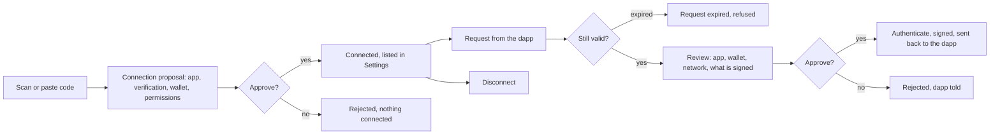

# WalletConnect

Connect the wallet to a dapp by scanning or pasting its code, then approve or reject what the dapp asks to sign: a message or a transaction. A switch to another network follows the dapp without a review.

1. The user scans or pastes a WalletConnect code; the proposal shows the app, its verification level, the wallet it will connect and the permissions ("View your balance and activity", "Send approval requests").
2. Approve connects the wallet; the connection appears under WalletConnect in Settings with the app, the wallet and the networks, and can be disconnected there.
3. A request from a connected dapp opens a review: the app, the wallet, the network, and the message or transaction to sign, with the same fee and simulation warnings as any transfer.
4. Approve signs it with the device's authentication and returns the result to the dapp.

## Expected results

| When | Expected | Why |
|---|---|---|
| The dapp fails verification | the proposal shows it before the user connects | |
| A request to sign comes for a wallet that is not the current one | that wallet becomes current before the request shows, the wallet's screens return to its main screen, and it stays current after the user signs or rejects | the request, its fee and any Buy, Swap or Receive it offers all belong to the connected wallet |
| The user rejects a request | a refusal goes back to the dapp | |
| A new request arrives while another one is on screen | the new request shows and the earlier one is refused, so its dapp is told | the earlier review is gone and can no longer be approved |
| A new request arrives while an approved request or connection is still being sent | the answer still reaches its dapp | the user already approved it |
| The same connection code is opened again while its proposal is on screen | the proposal stays; approving or rejecting it closes it | the SDK delivers a pending proposal again when its code is paired twice |
| A second connection is approved before the first dapp confirms its own | each connection is listed under, and signs with, the wallet it was approved with | a request is reviewed and signed by its connection's wallet (`sessions that settle out of order are stored for the wallet that approved each`) |
| The app is opened with a dapp already connected and a new dapp's code arrives at once | the new proposal shows and can be approved | the SDK is set up once; set up twice, it delivered the proposal twice and refused the copy, so the dapp saw the connection fail |
| A request has expired | "Request expired"; it cannot be approved and is never signed | |
| A message to sign comes from a site flagged as malicious | it is refused before anything is signed | a message to sign is checked like a transaction |
| A permit to sign names a flagged spender | a critical warning on the review | |
| A permit to sign has an amount or deadline Gem can't read, or lets a spender take several tokens at once | the review still warns about the approval, as unlimited when the amount can't be read | a drainer shouldn't escape the warning by writing its permit differently |
| A transaction names a sender other than the session's account, on an EVM network or Tron | it is refused before anything is signed | the review reads as a send from the session's account |
| A one-click sign-in names a different site than the app asking | it is refused and the app is told so | the signature would log the user in to that other site |
| A one-click sign-in is approved while another dapp connects with another wallet | each connection is listed under, and signs with, the wallet it was approved with | a sign-in keeps only the connections of the wallet that signed in |
| A transaction approves a token: an approval, an allowance increase or a Permit2 approval | the review shows a token approval with the token, spender and amount; a flagged spender or token stops Confirm | the spender is who can move the token afterwards |
| A transaction approves a token and also sends coins | the review shows a contract call headed by the coins it sends, not the approval, with the predicted balance changes | the review shows everything that leaves the wallet, even when the balance trace fails |
| A transaction on Solana, TRON or TON sends the network's coin from the wallet | the review is headed by the amount it sends, and the balance must cover that amount plus the fee | the review shows everything that leaves the wallet, even without a simulation |
| A TRON call also sends a TRC-10 token | a warning on the review names the token and amount, and Confirm stays open | the review shows everything that leaves the wallet, and dapps built on TRC-10 keep working |
| An approval or permit names a spender that is a wallet rather than a contract, including a wallet running delegated EIP-7702 code | a warning on the review | approving a wallet is how drainers take tokens, and a delegated wallet is still moved by whoever holds its key |
| A dapp asks to switch to a network Gem supports where the wallet has an account | the network joins the connection and the dapp switches, with no review | the address is the same on every Ethereum-style network, so nothing new is shared |
| A dapp asks to switch to a network Gem does not support | the dapp is told the network is unknown; nothing shows | |
| A dapp connected only on non-Ethereum networks asks to switch | the dapp is told the network is unknown | it was never given the Ethereum address |
| A WalletConnect Pay link | a payment review instead of a connection (see [Transfer](transfer.md)) | |
| A WalletConnect Pay verification page is over https on the payment's own host | it loads | |
| A WalletConnect Pay verification page is anywhere else | it opens in the browser | |
| The verification page reports a failure | it closes and the user sees an error instead of waiting on it | |

## Toasts

Toasts follow the shared [Toasts](../PRODUCT.md#toasts) section.

| When | Toast | Shows on |
|---|---|---|
| A WalletConnect link is scanned, pasted or opened | 🌐 WalletConnect... | any screen, until the connection sheet opens |
| A payment link is being prepared | 🌐 Loading | any screen, until the payment opens |
| A payment's gateway reports a problem after paying | ❌ the gateway's message | where the user lands after Confirm |
| A payment's verification fails | ❌ An error occurred! | where the user lands |
| A verified payment cannot be prepared | ❌ the reason | Payment verification |

## Platform differences

| When | iOS | Android | Expected |
|---|---|---|---|
| A dapp asks to sign in with one-click authentication | not supported | supported | Intentional |

## Rules

- A request is signed only from its review screen.
